# Formula 1 Podium Prediction: Milestone 1 Report

**Data:** Formula 1 World Championship 1950–2024 (Kaggle / Ergast), 14 tables. **Unit of analysis:** one driver entering one race. **Target:** podium finish (`positionOrder` ≤ 3). **Prediction cutoff:** after qualifying, before the race starts.

All numbers and figures come from the notebook `acl_milestone1.ipynb`, where every step, check and limitation is shown in full. References such as (§7.3) point to the notebook's sections.

**Contents**

1. Data, cleaning and EDA
2. Data-engineering questions
3. Selected features and why each is valid at the pre-race cutoff
4. Training seasons, split and preprocessing
5. Models and results
6. Model explainability (XAI)
7. Inference function
8. Known limitations

---

## 1. Data, cleaning and EDA

### 1.1 EDA before cleaning (§1)

**Hidden missing values.** Six tables write a missing value as the text `\N`: `races` (56.0% of its cells), `results` (25.5%), `drivers` (20.1%), `constructor_results` (20.0%), `qualifying` (12.3%) and `sprint_results` (1.3%). Read with no options, pandas counts none of them as missing and reads every column that holds `\N` as text.

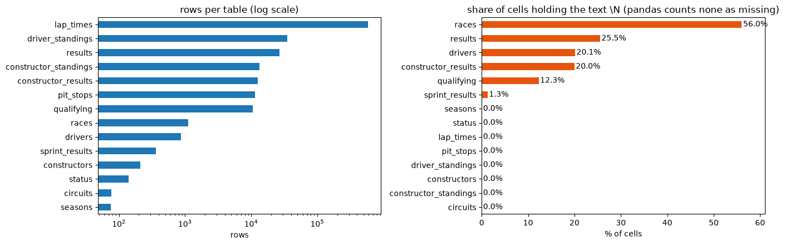

**Coverage over time.** `results` and `driver_standings` cover every season from 1950, the constructor tables start in 1958, `qualifying` in 1994, `lap_times` in 1996, `pit_stops` in 2011 and `sprint_results` in 2021. Qualifying covers 94–100% of the races in 1994–1995, only 6–59% in 1996–2002, and every race from 2003. This decides the training seasons (section 4).

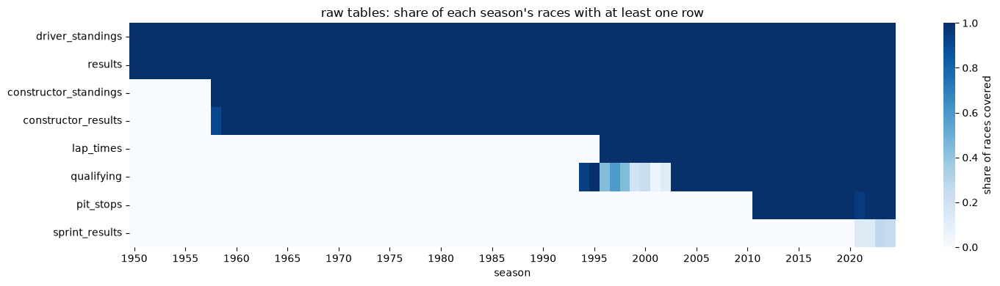

**The target and the grain.** 3,397 of the 26,759 result rows (12.7%) are podiums, so the positive class is rare in every era. The table is not yet one row per driver per race: 176 rows sit in 85 repeated (`raceId`, `driverId`) pairs, and 18 races (1950–1960) have more than 3 podium rows.

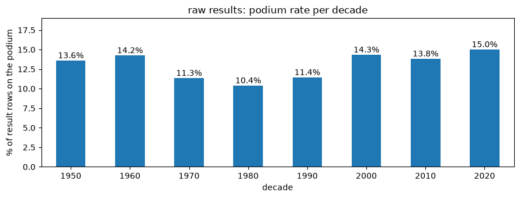

### 1.2 Cleaning decisions (§2, §3)

**Raw files stay unchanged.** Every table is read again from its CSV with `\N` as missing (`load()`), so each cleaned table is a new copy and the CSVs are never modified.

**Semantic typing.** Dates and durations written as text are converted, and the original column is kept beside the new one.

| Column | Table | Converted to |
|---|---|---|
| `date` and the five session dates | races | datetime |
| `dob` | drivers | datetime |
| `q1`, `q2`, `q3` | qualifying | seconds |
| `fastestLapTime` | results, sprint_results | seconds |
| `duration` | pit_stops | seconds |

**One row per driver per race.** In the 85 repeated pairs (shared drives from 1950–1964, plus 3 drivers entered in two cars who started in neither) we keep the row with the **best `positionOrder`**. In every pair this is also the row with the most laps, no two rows of a pair share a `positionOrder` (so the rule always picks exactly one), and it does not rely on `grid`, which is unreliable inside a pair (Clark, 1964, has grid 1 in both rows). The rule removes 91 rows and (`raceId`, `driverId`) is then unique. All 85 pairs are from 1950–1978, so none is in the seasons the model uses.

**Rows removed or flagged.**
- **Drivers who failed to qualify** (1,366 rows) are flagged, kept while the history features are built, then removed: they are the only drivers known before the cutoff not to race. Every other driver stays as a normal entry.
- **The Indianapolis 500** (381 rows, 11 races) is excluded: a different race with different drivers, and the constructor tables record it inconsistently.
- **Grid 0** rows are put at the back of the field in a new column, `grid_clean`.

**Keys.** All 14 tables pass: every primary key is unique and never empty, and no foreign key has an orphan (§2, *Key checks for all 14 tables*).

**Leakage rules found during the audit.** The standings rows of a race are written after that race (99.8% of the driver rows match the points scored that weekend), so only the previous round is used. Status, laps, points, the fastest lap and the finishing time are only known after the race and are never features.

### 1.3 EDA after cleaning (§4)

**Rows.** `results` goes from 26,759 rows to 26,668 (duplicates), 25,302 (failed to qualify) and 24,921 modelling rows (Indianapolis 500).

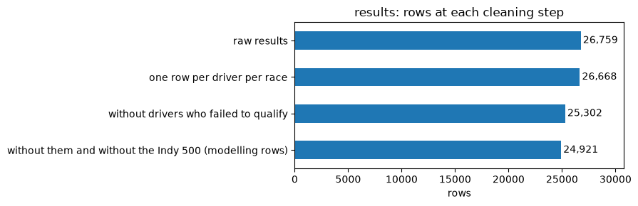

**Missing values and types.** After cleaning, each column's missing count equals its `\N` count (lower in `results` only because of the removed duplicate rows). Text columns fall from 9 to 3 in `results`, 14 to 8 in `races`, 8 to 6 in `drivers` and 6 to 3 in `sprint_results`.

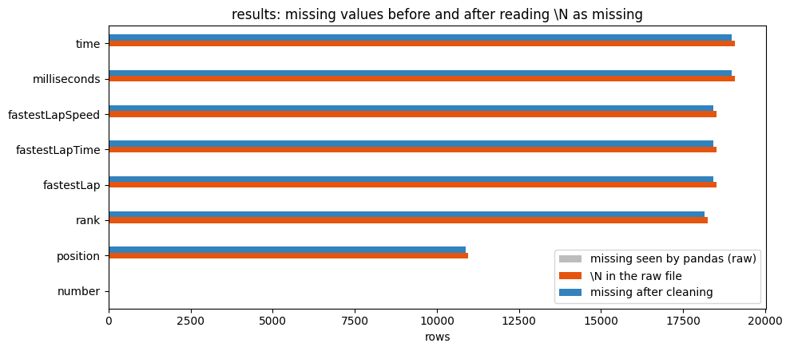

**Target and grid.** The podium rate rises from 12.7% to 13.5%, because the removed rows hold almost no podiums (none among the failed qualifiers, 36 in the Indianapolis 500). The 1,638 raw rows with grid 0 become back-of-the-field slots in `grid_clean`.

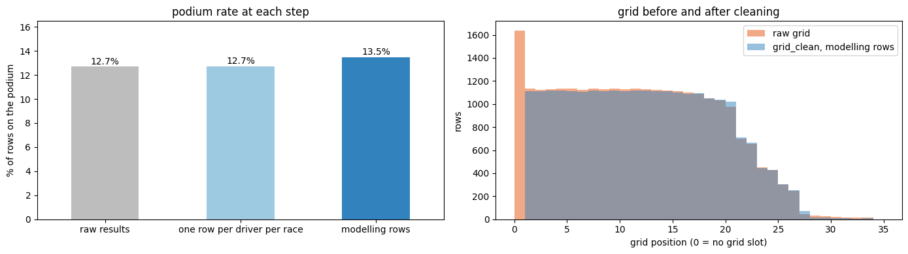

---

## 2. Data-engineering questions

### Q1. Which circuits convert a front-row start into a podium most often, and did that change after 2014?

**Approach.** A front-row start is grid slot 1 or 2. For each circuit we count how often front-row starters reach the podium, in 1980–2013 and in 2014–2024. Two corrections make circuits comparable: circuits with few races are pulled towards the normal rate (10 "pretend" starts at that rate), and each circuit is compared with the normal rate *of the seasons it was used in*, because cars broke down far more often in the 1980s than later. The 1980 start is when the staggered two-wide grid became standard, so grid 1–2 always means the front row.

**Qualifying position or grid slot?** We use the grid slot. In 96% of cases they agree, but drivers who qualified on the front row and were moved back (for example by a penalty) reached the podium only **31%** of the time, against **73%** for drivers who kept their slot.

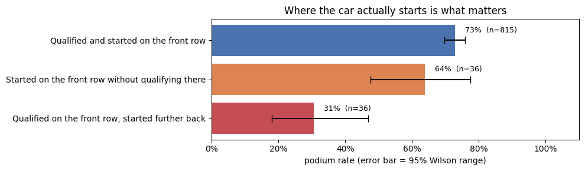

**Answer.**
- **1980–2013:** Magny-Cours, Paul Ricard and Hermanos Rodríguez (Mexico) convert most often, 7 to 14 percentage points above the normal rate of their seasons.
- **2014–2024:** Monaco, Suzuka and Yas Marina (about 7–8 points above normal), followed by Barcelona and Spa.
- These circuits stay on top under every choice we tested (number of pretend starts, minimum sample).

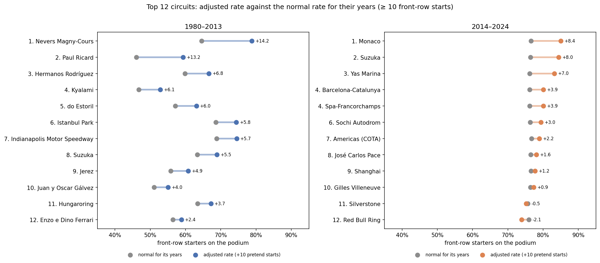

**Did the ranking change after 2014?** For the 16 circuits used in both periods, the two rankings look very different (rank correlation ρ = −0.04). But each circuit has only about 10 races per period, so a ranking shuffles a lot by chance alone: in a simulation where no circuit changed, rankings were as shuffled as reality **29%** of the time (17–31% across all settings). **The change can be explained by luck, so the data cannot show that the hybrid era changed which circuits convert best.**

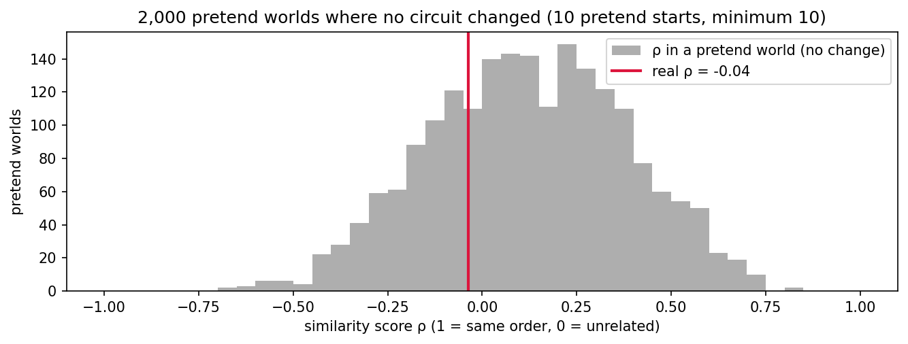

**Grain, missingness, cutoff.** One front-row starter per race (two rows per race); both front-row slots are recorded in 99% of races, and the missing ones are cars that did not start. The grid slot is fixed before the race, so a front-row start is known at the prediction cutoff.

---

### Q2. Do drivers podium more often at home, after controlling for starting position?

**Approach.** A start is a home start when the circuit is in the driver's country (nationalities mapped to countries; a driver with two nationalities is at home in both). Home and away starts are compared only from the same starting slot in the same decade, and in the main result each driver is compared **with themselves**: their home starts against their own away starts. Shared cars from the 1950s are left out, because their result belongs to two drivers.

**Why control for the starting position.** Without any control, home drivers reach the podium *less* often (11.7% vs 13.8%), because they start further back on average (many early home starts were local drivers in slow cars).

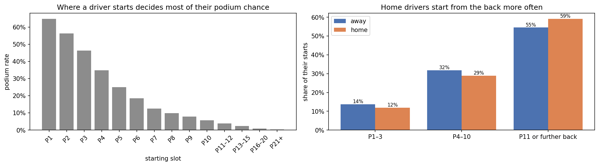

**Answer. No detectable home advantage.** Compared with themselves, from the same slot and decade, drivers reach the podium about as often at home as elsewhere: odds ratio **1.00** (95% range 0.77–1.27). Even if there is a home advantage, it is small: at most about **6 percentage points** for a P3 starter (46% → 52%). All 7 checks (other start years, including the Indianapolis 500, other matching rules) agree.

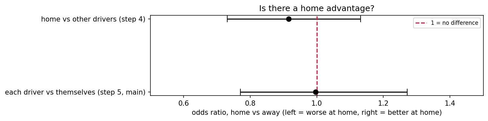

**Grain, missingness, cutoff.** One driver per race; the home flag has no missing values once every nationality is mapped. The starting position and the home flag are both known before the race.

---

### Q3. Which constructors have the highest mechanical-retirement rate in 2014–2021 vs 2022–2024?

**Approach.** A mechanical retirement is a race start that ended because a part of the car failed (not a crash, the driver or a stewards' decision). Every status label is placed in a group; only clear mechanical failures count, and unclear labels (for example `Retired` with no reason) give an upper bound. The rate is mechanical retirements ÷ starts; cars that never started are left out. As in Q1, teams with few starts are pulled towards normal, and each team is compared with the normal rate of its own seasons.

**Answer.**
- **2014–2021** (average 8.8% of starts): **Toro Rosso, Caterham and Lotus F1** broke down most often. Mercedes was the most reliable.
- **2022–2024** (average 5.4%): **Alfa Romeo and Alpine** clearly broke down most often; RB is third but only about 1 point above normal. Aston Martin and McLaren were the most reliable.
- Some teams changed name inside a period (for example Alfa Romeo and Sauber are the same team), so the same factory can appear twice.

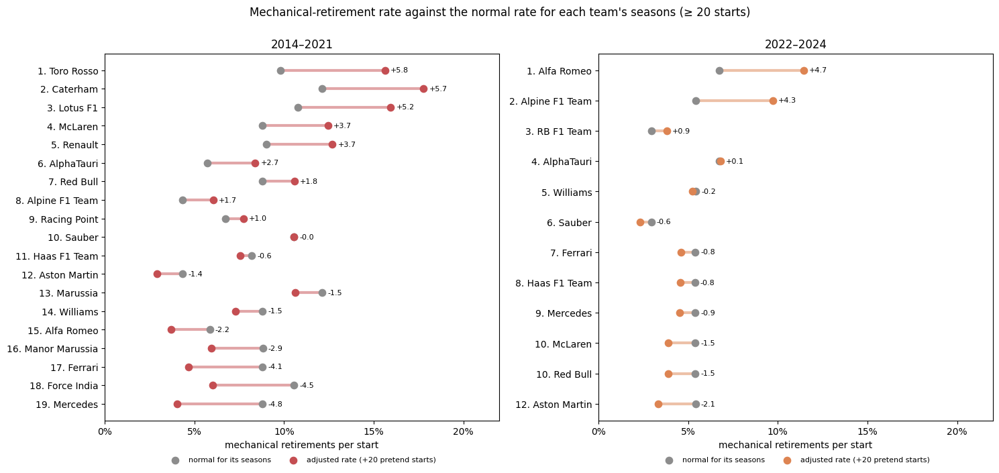

**Context.** Cars did become more reliable (8.8% → 5.4% of starts, a clear drop), but most of the improvement happened **before** the 2022 rules: against 2019–2021 the change is not clear (5.9% → 5.4%). McLaren, the Faenza team (Toro Rosso / AlphaTauri / RB) and Red Bull broke down clearly less after 2022; no team became clearly less reliable.

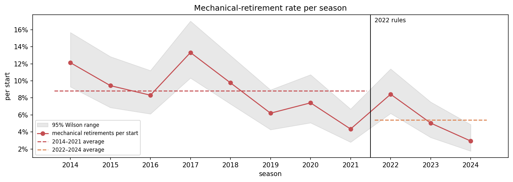

**Grain, missingness, cutoff.** One car start per race, 2014–2024; every status label has a group, so nothing is missing. The reason a race ended is only known after the race, so it is never a model input; here it is the answer to a descriptive question.

---

**Note on all three answers:** these are associations found in the data, not causes.

## 3. Selected features and why each is valid at the pre-race cutoff

**The cutoff.** We predict once qualifying is over and the starting grid is set, including grid penalties. A feature may only use what is known at that moment. Three rules make every feature valid (§7):
- **History features look only backwards.** They are computed over the races *before* the one being predicted, ordered by `(year, round)` (never by `raceId`), and the current race is left out with `shift(1)`, so no value contains the race's own result.
- **Standings come from the previous round.** A standings row already contains its own race, so round r uses round r − 1; round 1 uses last season's final position.
- **Outcome columns are never features.** The race result, status, laps, points, fastest lap, and the race's own lap times and failures (`race_pace`, `mech`, `crash`) are used only to build history from earlier races.

**The 9 features.** Each was chosen with evidence in §7. The AUC (how well the feature alone separates podium from non-podium starts; 0.5 = coin flip) is measured on the model rows that have a value.

| Group | Feature | What it is | Why it is valid at the cutoff | AUC | Has a value |
|---|---|---|---|---|---|
| grid | `grid_clean` | starting slot, pit-lane starters at the back | the grid is fixed before the start | 0.887 | 100% |
| qualifying | `grid_minus_quali` | grid slot minus qualifying position (penalties) | qualifying is before the race | 0.541* | 42% |
| qualifying | `quali_gap_pct` | gap to the fastest Q1 lap, in % | qualifying is before the race | 0.826 | 41% |
| driver form | `form_podium_rate` | podium rate over the previous 10 starts | earlier starts only | 0.838 | 97% |
| driver form | `career_starts` | starts before this race | earlier starts only | 0.661 | 100% |
| driver standings | `champ_pos` | championship position after the previous round | previous round; round 1: last season | 0.841 | 96% |
| team form | `team_form` | team's podium rate over its previous 10 races | earlier races only | 0.845 | 99% |
| reliability | `team_mech_rel` | team's mechanical-failure rate minus the field's, previous 20 races | earlier races only | 0.668 | 99% |
| pace | `pace_form` | driver's typical lap ÷ the race's typical lap, previous 10 starts | earlier starts only | 0.858 | 45% |

\* `grid_minus_quali` only helps together with the grid slot (a driver moved back says little until you know where they start). The "has a value" column covers all seasons; from 2003, every feature has a value for at least 94% of the rows in every season.

**The evidence behind each group (§7.1–7.8).**
- **Grid.** The podium rate falls steeply with the starting slot: 56% from P1–3, 16% from P4–10 and 1.6% from P11 or further back.

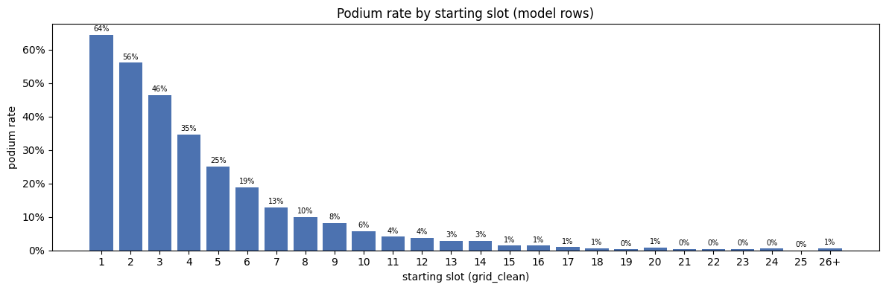

- **Qualifying.** The gap to the fastest Q1 lap matters beyond the position: within 0.25% of the fastest lap, about 56% reach the podium; over 3% slower, about 1%. A car moved back by a penalty still does better than the cars around it on the grid. `quali_pos` itself is not kept: it equals `grid_clean` − `grid_minus_quali` (Spearman 0.96 with the grid).

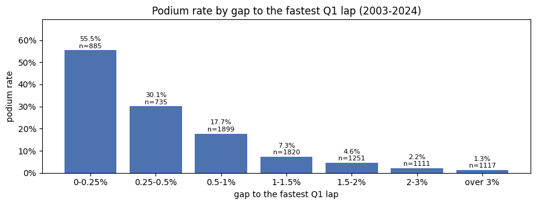

- **Driver form.** A 10-start window is close to the best and still describes recent form. From the same starting area, drivers with more than 3 podiums in their last 10 starts reach the podium far more often than drivers with none (for example about 34% against 7% from P4–10), so form adds information beyond the grid.

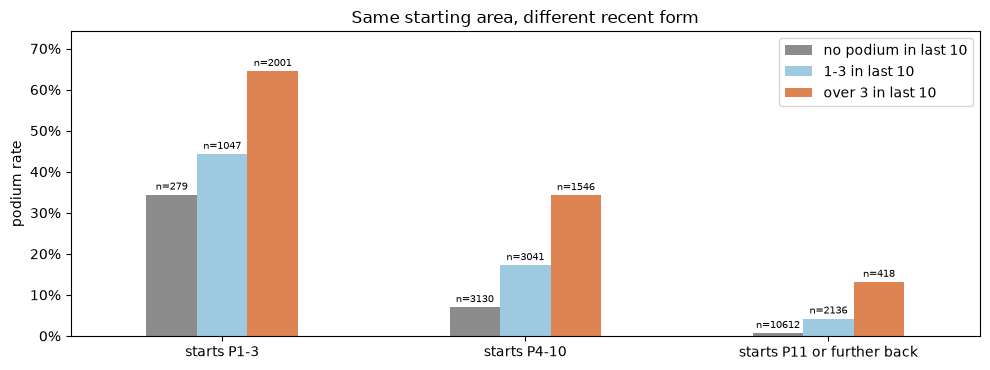

- **Driver standings.** The championship leader reaches the podium about 60% of the time, a driver 11th or lower about 3%. With the same recent form, a higher championship position still means more podiums.

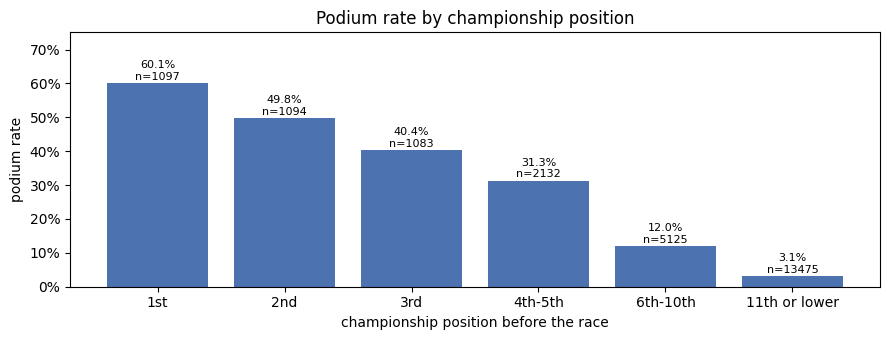

- **Team form.** It describes the car, measured on both cars. It was preferred to the constructor standings because it is slightly stronger (AUC 0.845 against about 0.84 for the team's points share), it has a value for 99% of the rows against 88%, and it is not misled by the championship table (McLaren 2007, excluded from the constructors' championship, would rank last).

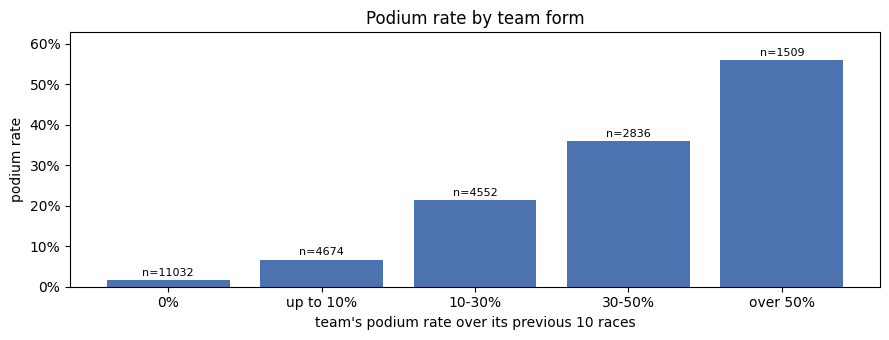

- **Reliability.** Weak alone (a breakdown is only one way to miss the podium), but teams that fail less often than the field reach the podium more often, and it adds a little for the stronger teams. It is measured **relative to the field**, because a 10% failure rate was average in the 1980s and very poor in 2024.

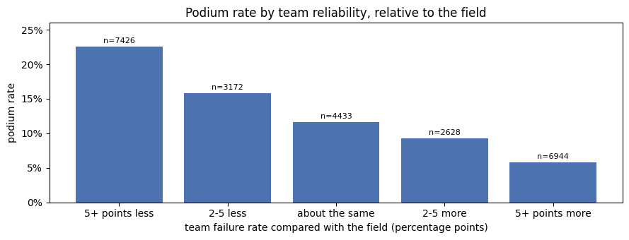

- **Pace.** Lap times show speed even in races that ended in a crash or a breakdown, which result-based features cannot see. Among drivers in strong form in a strong team, the fastest third reach the podium far more often than the slowest third. Only races with at least 10 laps count, so a two-lap race with a red flag cannot distort it.

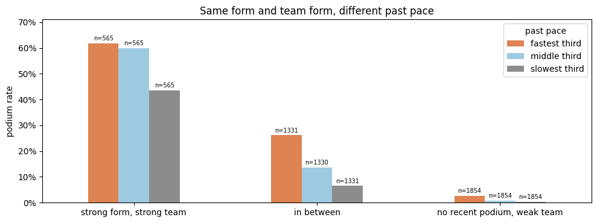

**Coverage and overlap.** The qualifying features are the only ones with a coverage problem (complete again only from 2003), and no two features say the same thing: the strongest overlaps are pace with the championship position (0.80) and driver form with team form (0.79), all below the 0.96 that led us to drop `quali_pos`.

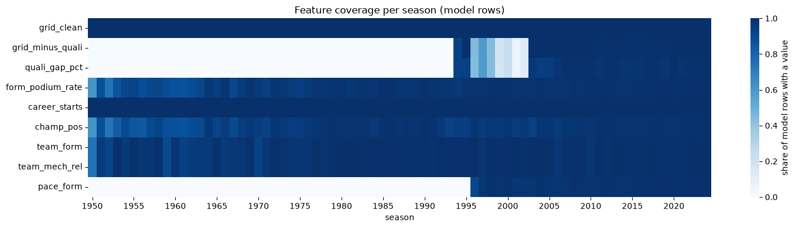

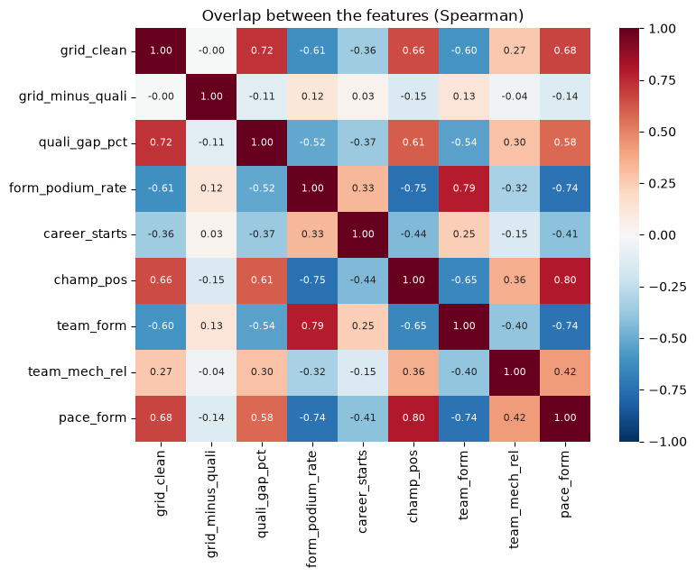

**Tested and not used**, with the trials kept in the notebook: `quali_pos` (same as the grid), `pit_lane_start` (only recorded from 2015, already in `grid_clean`), the average finishing position (weaker than the podium rate), the standings points share and wins (same information as `champ_pos`), the constructor standings (see team form), driver-level failure and crash rates (weaker, repeat the team's), circuit history (AUC 0.672, missing for 30% of the rows, §7.7), the sprint result (only 1.4% of the rows, §7.9) and a teammate grid-gap feature (added nothing, §10.8).

---

## 4. Training seasons, split and preprocessing

### 4.1 Training seasons and split (§8)

**First season: 2003.** The qualifying table is only 6–59% filled in 1996–2002 and complete from 2003. From 2003, every feature has a value for at least 94% of the rows in every season. Whether the qualifying and pace features are worth leaving out the older seasons was tested with the models (§10.8, section 5.5 below).

| Part | Seasons | Races | Rows | Podiums | Podium rate | Used for |
|---|---|---|---|---|---|---|
| Training | 2003–2018 | 300 | 6,407 | 900 | 14.0% | learning the models |
| Validation | 2019–2021 | 60 | 1,200 | 180 | 15.0% | choosing settings, thresholds, the final model and the features |
| Test | 2022–2024 | 68 | 1,359 | 204 | 15.0% | the final score, used once |

**Why split by whole seasons, in time order.** It matches real use (the model predicts future races from past ones), it keeps the drivers of one race together (only 3 of them can finish on the podium, so a random split would leak part of the answer), and it keeps the history features honest. The test seasons start with the new car rules of 2022, the hardest and most honest test. Validation keeps 2019 because a larger validation set gives less noisy scores (AUC error ±0.016 against ±0.019 with 2020–2021 only).

### 4.2 Preprocessing (§9)

Every value learned from data (a median, a limit, a mean) is learned from the **training part only** and applied unchanged to validation and test.

- **Filling.** No row is dropped: the gaps are mostly debuts and new teams, and the model must still predict for them. Each feature is filled according to *why* it is missing: `form_podium_rate` → 0 (no podium yet), `grid_minus_quali` → 0 (not moved), `quali_gap_pct` → the driver's own recent median gap, `champ_pos` → the worst position in the same race + 1, and `pace_form`, `team_form`, `team_mech_rel` → the training median.
- **Capping.** `quali_gap_pct` is capped at 7%, from the sport's 107% rule (a few laps up to 45% slower were spins, crashes or rain, not slow cars). `team_mech_rel` and `pace_form` are capped at the 1st and 99th percentiles of training, because a team's or driver's first races give extreme averages from very few races.
- **Scaling.** Standardisation with the training mean and standard deviation, needed by logistic regression and the neural network (trees are unaffected).

**Effect on the data.** Filling barely moves the distributions (0.3–2% of training values were filled). Capping shortens three ranges: `quali_gap_pct` from a maximum of 33.3 to 7.0, `team_mech_rel` from −0.23…0.92 to −0.165…0.356, `pace_form` from 0.968…1.190 to 0.979…1.054. The medians and every feature's AUC are unchanged.

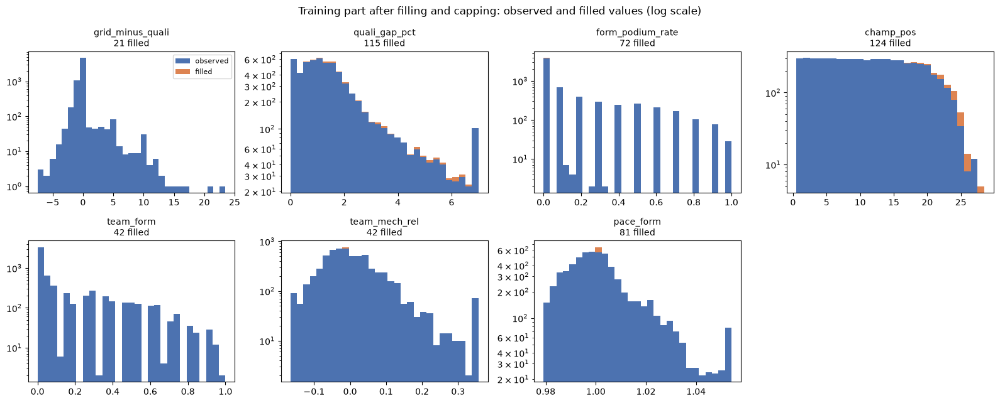

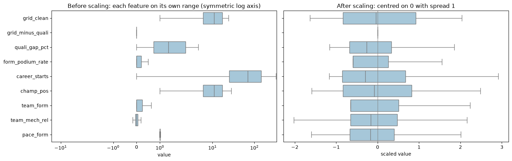

### 4.3 Preprocessing-order experiments (§9.6)

Both experiments train the baseline (logistic regression) and score it on the validation part only.

| Experiment | A (our order) | B (other order) | Validation PR-AUC A → B | What changes in the data |
|---|---|---|---|---|
| 1. Where the values are learned | split, then learn fill values, caps and scaling from training only | learn them from all seasons 2003–2024, then split | 0.7167 → 0.7168 | the `quali_gap_pct` fill value moves from 1.357 to 1.224, the `team_mech_rel` upper cap from 0.356 to 0.302, the `career_starts` mean from 92.6 to 103.9 |
| 2. Fill before or after scaling | fill, cap, then scale | cap, scale, then fill | 0.7167 → 0.7161 | a debut's form becomes 14% instead of 0, and a driver with no standing is placed about 28th instead of about 22nd |

**Reading.** The scores barely move, because only a few percent of the values are filled or capped. The order still matters: in experiment 1 the validation and test seasons help prepare the training data (leakage), and in experiment 2 the fill rules lose their meaning ("no podium yet" becomes "an average podium rate"). Our order (split, fill, cap, scale, all learned on training) is kept.

---

## 5. Models and results

### 5.1 The three models (§10.2–10.4)

All three use the same modelling table: the same rows, the same 9 features and the same split. Every setting, threshold and stopping point is chosen on the validation part.

| Model | How it works | Chosen settings | Main limitation |
|---|---|---|---|
| **Logistic regression** (baseline) | a weighted sum of the features turned into a probability by the S-shaped logistic curve | `C` = 100 (any `C` ≥ 0.1 scores 0.713–0.717) | straight-line effects only: P2 → P1 counts the same as P16 → P15 |
| **Gradient boosting** (`HistGradientBoostingClassifier`) | many small trees built one after another, each correcting the previous ones' mistakes | depth 3, learning rate 0.03, 300 trees (depth 2 and 3 practically tied; deep trees memorise: depth 5 at rate 0.1 reaches 0.985 train vs 0.684 validation PR-AUC) | harder to explain; cannot go beyond values seen in training |
| **Shallow neural network** (PyTorch) | 9 inputs → one hidden layer of 32 ReLU units → 1 output; Adam, batches of 256, early stopping after 25 epochs without improvement | one hidden layer of 32, no weight decay, best epoch 215 (of six one- and two-layer variants tried) | the score depends on the random start: 0.735 ± 0.008 over 5 seeds |

All three score each row on its own: none of them knows that a race has exactly 3 podiums.

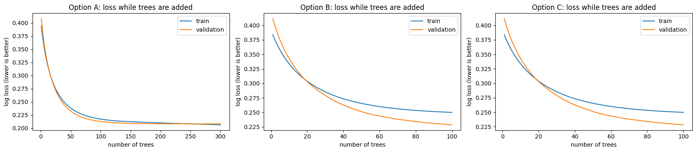

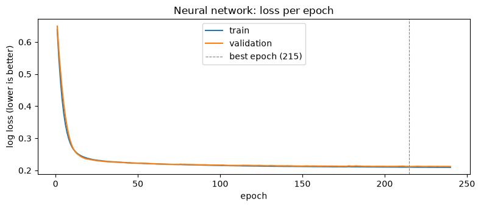

### 5.2 Metrics: primary and secondary (§10.1, §10.10)

- **Primary: PR-AUC.** Podiums are the rare class (about 15% of rows) and the class we want to find. PR-AUC measures how well podium finishers are ranked at the top and needs no threshold. It is used to choose every setting, the final model and the features.
- **Secondary: F1**, at the threshold that gives the best F1 on the **validation** part (never the test part). It scores the yes/no answers the model would actually give.
- **ROC-AUC** is reported for every model but is high for everyone, the grid included, because 58% of non-podium drivers start P11 or further back and are easy to rank. **Accuracy** is misleading: answering "no podium" for everyone is already 85% accurate.
- Precision, recall and the **top 3 per race** (how many of each race's 3 most likely drivers reached the podium) are reported as extra checks. "The top 3 on the grid finish on the podium" is the reference that needs no model.

### 5.3 Model comparison (§10.5, §10.9)

Training and validation scores come from models trained on 2003–2018; test scores from the same models trained again on 2003–2021, with every setting and threshold unchanged.

| Model | Part | ROC-AUC | PR-AUC | F1 | Precision | Recall | Top-3 per race |
|---|---|---|---|---|---|---|---|
| Logistic regression (baseline) | train | 0.927 | 0.675 | 0.652 | 0.612 | 0.698 | 0.642 |
| | validation | 0.932 | 0.717 | 0.730 | 0.679 | 0.789 | 0.678 |
| | **test** | **0.937** | **0.717** | **0.673** | 0.643 | 0.706 | 0.652 |
| Gradient boosting (final model) | train | 0.949 | 0.751 | 0.702 | 0.698 | 0.706 | 0.690 |
| | validation | 0.940 | 0.744 | 0.729 | 0.725 | 0.733 | 0.706 |
| | **test** | **0.938** | **0.705** | **0.645** | 0.658 | 0.632 | 0.647 |
| Shallow neural network | train | 0.938 | 0.703 | 0.670 | 0.628 | 0.719 | 0.661 |
| | validation | 0.938 | 0.746 | 0.735 | 0.684 | 0.794 | 0.700 |
| | **test** | **0.935** | **0.704** | **0.682** | 0.648 | 0.721 | 0.667 |
| The top 3 on the grid (reference) | validation | 0.917 | 0.676 | 0.717 | 0.717 | 0.717 | 0.717 |
| | test | 0.913 | 0.645 | 0.647 | 0.647 | 0.647 | 0.647 |

F1 thresholds chosen on validation: 0.368 (logistic regression), 0.421 (gradient boosting), 0.369 (neural network).

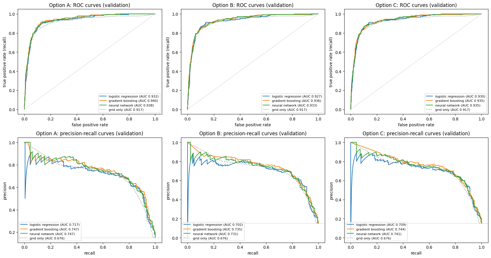

**The final model: gradient boosting (§10.6).** On validation it has the best ROC-AUC (0.940) and ties with the network on PR-AUC (0.744 against 0.746; difference −0.002, 95% range −0.027 to +0.024). Its lead over the baseline (+0.027) is not clear either (range −0.005 to +0.055), because the validation part holds only 60 races. Gradient boosting is preferred because it gives the same model every time it is trained (the network's score moves with its random start, and its 5-seed average is 0.735), it learns curved effects and interactions by itself, and tree models can be explained exactly with SHAP (section 6).

### 5.4 Feature-group ablation (§10.7)

Each group is removed, gradient boosting is trained again with the same settings, and the change in validation PR-AUC is measured; logistic regression is repeated as a second opinion. A change is **clear** when its 95% range (from redrawing the 60 validation races 1,000 times) does not include 0. The rule, set before the experiments: a group is removed only if the model is clearly better without it.

| Group removed | Gradient boosting PR-AUC | Change | 95% range | Clear? | Change (logistic regression) |
|---|---|---|---|---|---|
| none (all 9 features) | 0.744 | – | – | – | – |
| grid | 0.665 | −0.080 | −0.121 to −0.038 | **yes, worse** | −0.048 |
| reliability | 0.738 | −0.007 | −0.015 to +0.002 | no | +0.001 |
| team form | 0.740 | −0.004 | −0.013 to +0.005 | no | +0.007 |
| pace | 0.740 | −0.004 | −0.015 to +0.009 | no | −0.000 |
| driver form | 0.741 | −0.003 | −0.022 to +0.014 | no | +0.003 |
| driver standings | 0.741 | −0.003 | −0.014 to +0.007 | no | −0.006 |
| qualifying | 0.751 | +0.007 | −0.006 to +0.018 | no | −0.005 |

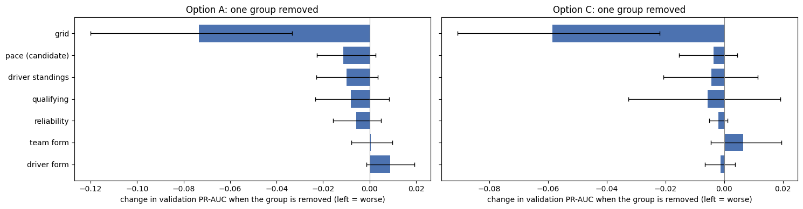

**Four more experiments** explain why only the grid is clearly needed:
- **One group alone (experiment 2).** Every group except reliability is strong on its own (grid 0.677, standings 0.630, pace 0.596, team form 0.590, driver form 0.575, qualifying 0.493; reliability 0.245; guessing about 0.15). So a small loss when a group is removed means the other groups **replace** it, not that it is useless.
- **Two groups removed (experiment 3).** Overlapping groups cover for each other: for example, standings and reliability together cost −0.017, more than either alone. Without the grid, every pair loses −0.070 to −0.103.
- **Every combination (experiment 4).** Many sets do about equally well: 36 of the 127 combinations are within 0.01 of all 9 features or better. The best one (grid, standings, pace: 0.761) is not clearly better (+0.017, range −0.005 to +0.038) and is the luckiest of 127 tries on the same races.
- **One feature removed (experiment 5).** Only `grid_clean` is clearly needed; no single feature makes the model clearly better when it is removed.

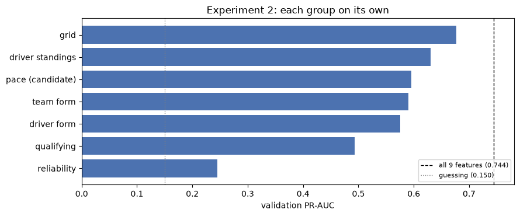

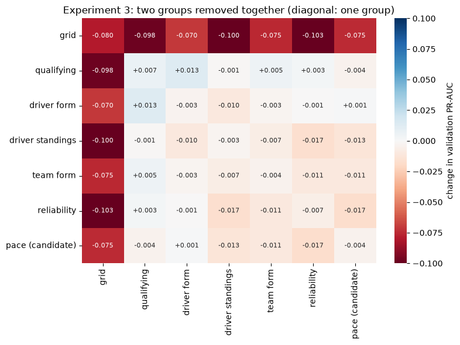

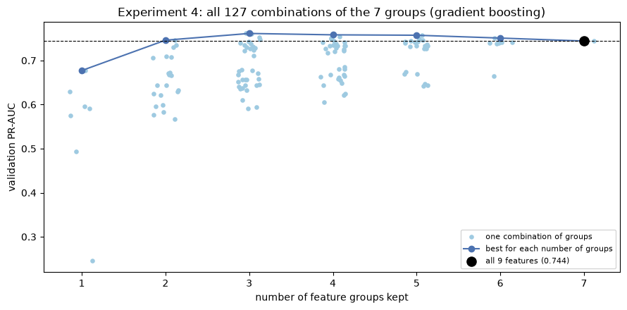

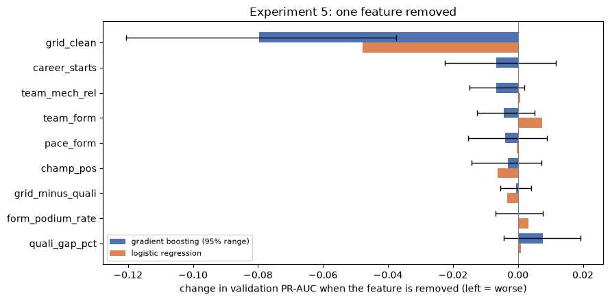

**Decision.** All 7 groups (the 9 features) are kept: none makes the model clearly better when removed, each was chosen with evidence and is valid at the cutoff, and the grid is the only group the model cannot do without.

### 5.5 Training on all seasons (§10.8)

Because the qualifying and pace features add little in the ablation, a second version was trained on **1950–2018** with the 6 features that exist in every season (about 22,400 training rows instead of 6,400). On validation it scored lower with all three models (PR-AUC 0.702 against 0.717 for logistic regression, 0.719 against 0.744 for gradient boosting, 0.729 against 0.746 for the network), none of the drops clear. The 2003 start with all 9 features is kept. On the test part, scored for comparison only, the two versions are about equal.

### 5.6 The final test (§10.9)

The test part (2022–2024) was used once, with every choice fixed beforehand.
- **All three models clearly beat the grid** on PR-AUC: +0.072 (logistic regression), +0.060 (gradient boosting) and +0.059 (network), with every 95% range above 0. Form, standings, team and pace information add something real beyond the starting order, also with the new 2022 cars.
- **The models are close to each other.** No difference between two models is clear (gradient boosting minus logistic regression: −0.012, range −0.039 to +0.015). The final model stays gradient boosting, because it was chosen on validation; switching on the test part would use the test to choose.
- **Every score is lower than on validation**, the grid's too (PR-AUC 0.676 → 0.645), so part of the drop comes from the seasons themselves. Gradient boosting's F1 threshold, best on validation, finds fewer podiums on the test part (recall 0.733 → 0.632).

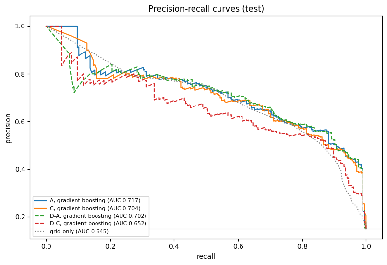

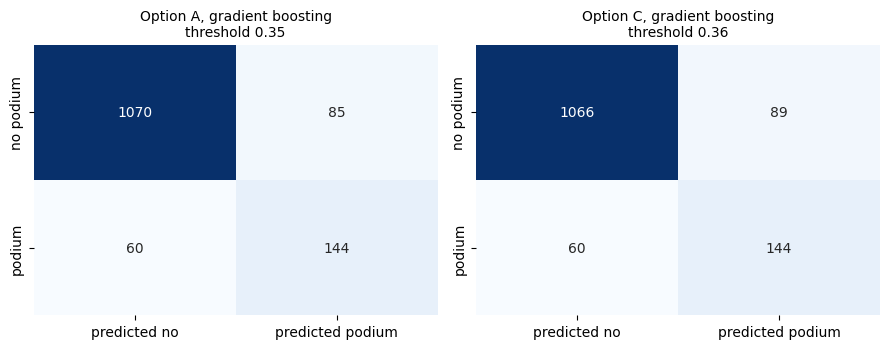

---

## 6. Model explainability (XAI)

**What is explained.** The final model (gradient boosting trained on 2003–2021) on the 1,359 driver-race rows of the test seasons 2022–2024, races it never saw during training. **Global** methods show what the model relies on overall; **local** methods show why it gave one driver one probability. Full details are in section 11 of the notebook.

**In short:** the model is mainly a grid model. Where a driver starts matters most; recent results (championship position, driver form, team form, pace) correct it; and its biggest mistakes come from what happens during the race, which it cannot know.

### 6.1 Global: what the model relies on

**Permutation importance.** One feature at a time is shuffled across the test rows, so it no longer says anything about the driver, and the drop in test PR-AUC is measured (20 shuffles each). Shuffling the grid slot lowers PR-AUC from 0.705 to about 0.37 (**−0.339**). The championship position comes second (−0.018); every other feature costs 0.006 or less, within the noise of the shuffles.

**This understates features that overlap.** Driver form, the championship position, team form and pace carry much of the same information (correlations up to 0.80), so when one is shuffled the model uses the others. Shuffled **together**, these four groups lower PR-AUC by **0.124**, almost four times the sum of their single drops (0.033). All features except the grid together cost **0.190**, about half as much as the grid: recent results are the model's second source of information, not an unimportant one.

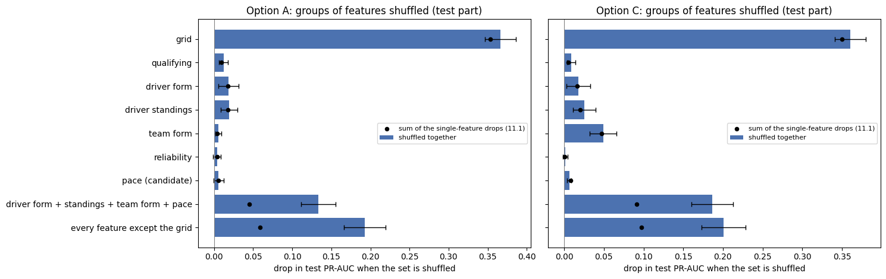

**SHAP.** SHAP splits each prediction into one contribution per feature: a positive contribution pushes the driver towards the podium, a negative one away from it. Contributions are on the model's log-odds scale and, for tree models, add up exactly to the model's output. Averaged over the test rows, the grid moves predictions most (1.04), followed by the championship position (0.37), driver form (0.28), team form (0.25), pace (0.24) and the qualifying gap (0.23). Reliability (0.13), career starts (0.11) and the grid penalty (0.01) matter less.

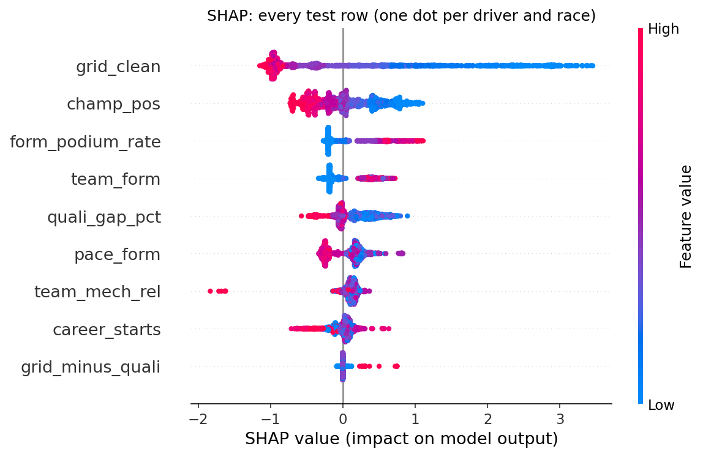

**What the effects look like.**
- **Directions match the feature analysis:** a front grid slot, a high championship position, recent podiums and a strong team push up; a slow qualifying lap or race pace pushes down.
- **The grid effect is curved:** pole adds about +3, the push falls to about 0 around P8, and from P12 back it is flat (P12 and P20 are treated the same). A linear model such as logistic regression cannot represent this.
- **Other effects work in steps:** leading the championship and being 2nd count the same, and the push turns negative from about 11th; driver form stops adding after about five podiums in the last ten starts.

**Are the explanations reliable?** Permutation importance, SHAP and the ablation (models trained again without each feature) all rank the grid first. They order the middle features differently, but those differences are small and within noise. The SHAP ranking is also nearly identical in each test season (rank correlation 0.93–0.95), so it is not driven by one season.

### 6.2 Local: single predictions

**SHAP waterfall.** Two drivers on the podium with similar probabilities, for opposite reasons:
- **Russell, Canada 2024, from pole (0.48):** pole adds +3.31; every other feature adds less than 0.2 either way.
- **Verstappen, Belgium 2023, from P6 after a grid penalty (0.54):** the grid adds only +0.63. More comes from his recent form (a podium in each of his last 10 starts, +0.92) and from leading the championship (+0.89).

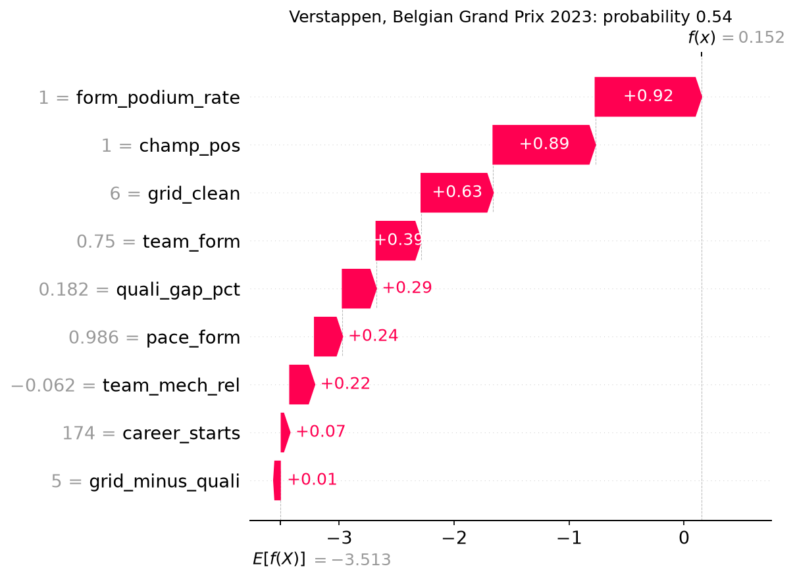

**A confident prediction that was wrong.** The model's most confident miss in the test seasons is Verstappen at Australia 2024: pole, probability 0.86, retired with a brake failure. Every feature pushed up (grid +2.89, championship +0.77, form +0.59), so the explanation is sensible; the cause of the miss is not in the information available before the race.

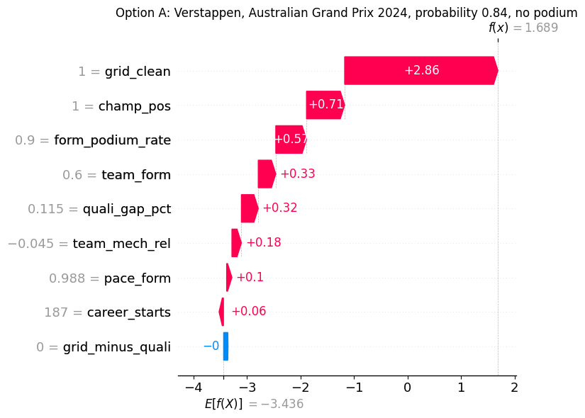

**LIME** fits a simple model around one prediction to approximate the real one. For Verstappen at Belgium 2023 it agrees with SHAP on the direction of every feature, with "grid ≤ 6" as the largest weight (+0.18 in probability). Its simple model gives 0.36 where the real model gives 0.54, so LIME is used as a cross-check and SHAP, which is exact for tree models, as the main method.

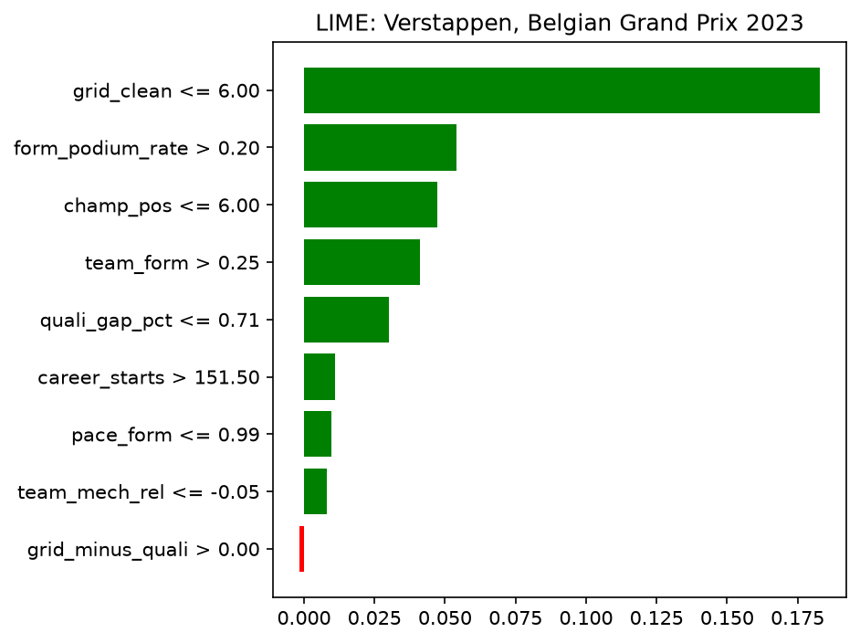

**A whole race.** At Australia 2024 the model's top three were exactly the top three on the grid; the other features only reorder neighbours, and every driver behind P10 gets 2% or less. This shows the model's main limitation: it improves the probabilities but rarely changes who is in the top three. On the test seasons, its top three per race reach the podium 64.7% of the time, the same as the top three on the grid.

### 6.3 What these explanations do not show

- **Importance is not causation.** A feature being important to the model is **not proof that it causes podium finishes**; it only means that the model relies on it to make predictions. For example, leading the championship does not make a driver faster: a fast car and a strong driver cause both the championship position and the podiums, and the model uses the championship position as a sign of them.
- **The grid slot mixes two things:** the advantage of starting at the front and how fast the car was in qualifying. The model cannot separate them.
- **Overlapping features share their importance,** so a feature that looks unimportant alone can still carry real information.
- **The explanations hold for this model and these seasons** (2022–2024); another model or other seasons could rely on the features differently.

---

## 7. Inference function

`predict_podium(record)` (§12) predicts one new record, one driver in one race at the cutoff. It takes the 9 features in their original units (any of them may be missing), fills the gaps with the rules of section 4.2 using values learned from 2003–2021, caps and scales them, runs the final model, and returns the podium probability, the yes/no answer at the threshold chosen on validation (0.421), and a table of the values the model actually used. A missing `champ_pos` is filled with the worst position in the race + 1, so for such a record the function also takes the worst championship position among the other drivers.

- **Complete record:** Verstappen, Belgian Grand Prix 2023, every feature known. Probability **0.54**, answer "podium" (he finished on the podium).
- **Partially-missing record:** Zhou, Bahrain Grand Prix 2022, his first race, with driver form, championship position and pace missing. They are filled with 0, 20 (behind every other driver) and the training median 1.000. Probability **0.00** from 15th on the grid, answer "no podium" (correct).

Both probabilities are exactly the ones the notebook computed for these rows in the final test, so the function repeats the pipeline's steps correctly.

---

## 8. Known limitations

**Data coverage**
- **Historical qualifying-coverage drift.** Qualifying data starts in 1994, covers only 6–59% of the races in 1996–2002 and is complete again from 2003; lap times start in 1996. The model therefore learns from 2003–2018 only and leaves more than 50 seasons unused. A version trained on 1950–2018 without these features scored lower on validation (section 5.5), but that comparison is not clear.
- **Pit-lane starts are only recorded from 2015.** Before that, the data gives pit-lane starters a slot at the back of the grid, so they cannot be flagged (`grid_clean` places both at the back, so the effect is small).
- **Renamed teams start with no history.** Brawn 2009 is not linked to Honda 2008, because a new name often means a new owner and car; a strong new team is first filled as "typical" and only the grid shows its speed.
- **Fill rules are guesses for debuts.** A rookie gets a form of 0 and a median pace. The few affected rows (0.3–2% per feature) and the fill rules are documented, but the model knows little about a driver's first race.

**Era sensitivity**
- **The sport's rules change.** Points systems, calendar length, car reliability and grid size change across eras, so raw totals are replaced by ranks, rates and values relative to the field. Even so, what a feature means can shift: for example, reliability matters less now that cars rarely break down.
- **New regulations.** The test seasons start with the 2022 car rules. Every score is lower on the test part than on validation, the grid's too (PR-AUC 0.676 → 0.645), so performance depends on the era; a future rule change could lower it again.
- **The validation-chosen threshold did not carry over** for gradient boosting: it found 73% of the podiums on validation but 63% on the test part.

**The models**
- **Mainly a grid model.** The grid slot is by far the most important input. The models clearly beat the grid on ranking (PR-AUC), but picking 3 drivers per race they do no better than the top 3 on the grid (test: 64.7% for gradient boosting, the same as the grid).
- **Each row is scored on its own.** No model knows that a race has exactly 3 podiums, so the probabilities within a race do not add up to 3.
- **What happens in the race is unknown at the cutoff.** Crashes, breakdowns, safety cars, weather and strategy decide many podiums, and the model's most confident mistakes are such cases (Verstappen, Australia 2024, pole and a brake failure).
- **Small evaluation sets.** Validation has 60 races and the test 68, so many differences are within luck: the final model is not clearly better than the baseline, and no two models differ clearly on the test part.
- **The neural network's exact numbers depend on the random start and the computer** (validation PR-AUC 0.735 ± 0.008 over 5 seeds).

**The data-engineering answers**
- They describe associations, not causes, and rest on small samples per circuit (about 10 races per period in Q1) and per team (Q3); Q2 relies on mapping nationalities to countries, and Q3 on grouping the status labels, where unclear labels such as `Retired` only give an upper bound.

**The explanations** describe the model, not Formula 1: an important feature is not proof that it causes podium finishes (section 6.3).
