# Formula 1 Podium Prediction: Milestone 1 Report

**Data:** Formula 1 World Championship 1950–2024 (Kaggle / Ergast), 14 tables. **Unit of analysis:** one driver entering one race. **Target:** podium finish (`positionOrder` ≤ 3). **Prediction cutoff:** after qualifying, before the race starts.

All numbers and figures come from the notebook `acl_milestone1.ipynb`, as run on Kaggle, where every step, check and limitation is shown in full. References such as (§7.3) point to the notebook's sections.

**Contents**

1. Data, cleaning and EDA
2. Data-engineering questions
3. Selected features and why each is valid at the pre-race cutoff
4. Training seasons, split and preprocessing
5. Models and results
6. Model explainability (XAI)
7. Inference function
8. Known limitations

---

## 1. Data, cleaning and EDA

### 1.1 EDA before cleaning (§1)

**Hidden missing values.** Six tables write a missing value as the text `\N`: `races` (56.0% of its cells), `results` (25.5%), `drivers` (20.1%), `constructor_results` (20.0%), `qualifying` (12.3%) and `sprint_results` (1.3%). Read with no options, pandas counts none of them as missing and reads every column that holds `\N` as text.

**Coverage over time.** `results` and `driver_standings` cover every season from 1950, the constructor tables start in 1958, `qualifying` in 1994, `lap_times` in 1996, `pit_stops` in 2011 and `sprint_results` in 2021. Qualifying covers 94–100% of the races in 1994–1995, only 6–59% in 1996–2002, and every race from 2003. This decides the training seasons (section 4).

**The target and the grain.** 3,397 of the 26,759 result rows (12.7%) are podiums, so the positive class is rare in every era. The table is not yet one row per driver per race: 176 rows sit in 85 repeated (`raceId`, `driverId`) pairs, and 18 races (1950–1960) have more than 3 podium rows.

### 1.2 Cleaning decisions (§2, §3)

**Raw files stay unchanged.** Every table is read again from its CSV with `\N` as missing (`load()`), so each cleaned table is a new copy and the CSVs are never modified.

**Semantic typing.** Dates and durations written as text are converted, and the original column is kept beside the new one.

| Column | Table | Converted to |
|---|---|---|
| `date` and the five session dates | races | datetime |
| `dob` | drivers | datetime |
| `q1`, `q2`, `q3` | qualifying | seconds |
| `fastestLapTime` | results, sprint_results | seconds |
| `duration` | pit_stops | seconds |

**One row per driver per race.** In the 85 repeated pairs (shared drives from 1950–1964, plus 3 drivers entered in two cars who started in neither) we keep the row with the **best `positionOrder`**. In every pair this is also the row with the most laps, no two rows of a pair share a `positionOrder` (so the rule always picks exactly one), and it does not rely on `grid`, which is unreliable inside a pair (Clark, 1964, has grid 1 in both rows). The rule removes 91 rows and (`raceId`, `driverId`) is then unique. All 85 pairs are from 1950–1978, so none is in the seasons the model uses.

**Rows removed or flagged.**
- **Drivers who failed to qualify** (1,366 rows) are flagged, kept while the history features are built, then removed: they are the only drivers known before the cutoff not to race. Every other driver stays as a normal entry.
- **The Indianapolis 500** (381 rows, 11 races) is excluded: a different race with different drivers, and the constructor tables record it inconsistently.
- **Grid 0** rows are put at the back of the field in a new column, `grid_clean`.

**Keys.** All 14 tables pass: every primary key is unique and never empty, and no foreign key has an orphan (§2, *Key checks for all 14 tables*).

**Leakage rules found during the audit.** The standings rows of a race are written after that race (99.8% of the driver rows match the points scored that weekend), so only the previous round is used. Status, laps, points, the fastest lap and the finishing time are only known after the race and are never features.

### 1.3 EDA after cleaning (§4)

**Rows.** `results` goes from 26,759 rows to 26,668 (duplicates), 25,302 (failed to qualify) and 24,921 modelling rows (Indianapolis 500).

**Missing values and types.** After cleaning, each column's missing count equals its `\N` count (lower in `results` only because of the removed duplicate rows). Text columns fall from 9 to 3 in `results`, 14 to 8 in `races`, 8 to 6 in `drivers` and 6 to 3 in `sprint_results`.

**Target and grid.** The podium rate rises from 12.7% to 13.5%, because the removed rows hold almost no podiums (none among the failed qualifiers, 36 in the Indianapolis 500). The 1,638 raw rows with grid 0 become back-of-the-field slots in `grid_clean`.

---

## 2. Data-engineering questions

### Q1. Which circuits convert a front-row start into a podium most often, and did that change after 2014?

**Approach.** A front-row start is grid slot 1 or 2. For each circuit we count how often front-row starters reach the podium, in 1980–2013 and in 2014–2024. Two corrections make circuits comparable: circuits with few races are pulled towards the normal rate (10 "pretend" starts at that rate), and each circuit is compared with the normal rate *of the seasons it was used in*, because cars broke down far more often in the 1980s than later. The 1980 start is when the staggered two-wide grid became standard, so grid 1–2 always means the front row.

**Qualifying position or grid slot?** We use the grid slot. In 96% of cases they agree, but drivers who qualified on the front row and were moved back (for example by a penalty) reached the podium only **31%** of the time, against **73%** for drivers who kept their slot.

**Answer.**
- **1980–2013:** Magny-Cours, Paul Ricard and Hermanos Rodríguez (Mexico) convert most often, 7 to 14 percentage points above the normal rate of their seasons.
- **2014–2024:** Monaco, Suzuka and Yas Marina (about 7–8 points above normal), followed by Barcelona and Spa.
- These circuits stay on top under every choice we tested (number of pretend starts, minimum sample).

**Did the ranking change after 2014?** For the 16 circuits used in both periods, the two rankings look very different (rank correlation ρ = −0.04). But each circuit has only about 10 races per period, so a ranking shuffles a lot by chance alone: in a simulation where no circuit changed, rankings were as shuffled as reality **29%** of the time (17–31% across all settings). **The change can be explained by luck, so the data cannot show that the hybrid era changed which circuits convert best.**

**Grain, missingness, cutoff.** One front-row starter per race (two rows per race); both front-row slots are recorded in 99% of races, and the missing ones are cars that did not start. The grid slot is fixed before the race, so a front-row start is known at the prediction cutoff.

---

### Q2. Do drivers podium more often at home, after controlling for starting position?

**Approach.** A start is a home start when the circuit is in the driver's country (nationalities mapped to countries; a driver with two nationalities is at home in both). Home and away starts are compared only from the same starting slot in the same decade, and in the main result each driver is compared **with themselves**: their home starts against their own away starts. Shared cars from the 1950s are left out, because their result belongs to two drivers.

**Why control for the starting position.** Without any control, home drivers reach the podium *less* often (11.7% vs 13.8%), because they start further back on average (many early home starts were local drivers in slow cars).

**Answer. No detectable home advantage.** Compared with themselves, from the same slot and decade, drivers reach the podium about as often at home as elsewhere: odds ratio **1.00** (95% range 0.77–1.27). Even if there is a home advantage, it is small: at most about **6 percentage points** for a P3 starter (46% → 52%). All 7 checks (other start years, including the Indianapolis 500, other matching rules) agree.

**Grain, missingness, cutoff.** One driver per race; the home flag has no missing values once every nationality is mapped. The starting position and the home flag are both known before the race.

---

### Q3. Which constructors have the highest mechanical-retirement rate in 2014–2021 vs 2022–2024?

**Approach.** A mechanical retirement is a race start that ended because a part of the car failed (not a crash, the driver or a stewards' decision). Every status label is placed in a group; only clear mechanical failures count, and unclear labels (for example `Retired` with no reason) give an upper bound. The rate is mechanical retirements ÷ starts; cars that never started are left out. As in Q1, teams with few starts are pulled towards normal, and each team is compared with the normal rate of its own seasons.

**Answer.**
- **2014–2021** (average 8.8% of starts): **Toro Rosso, Caterham and Lotus F1** broke down most often. Mercedes was the most reliable.
- **2022–2024** (average 5.4%): **Alfa Romeo and Alpine** clearly broke down most often; RB is third but only about 1 point above normal. Aston Martin and McLaren were the most reliable.
- Some teams changed name inside a period (for example Alfa Romeo and Sauber are the same team), so the same factory can appear twice.

**Context.** Cars did become more reliable (8.8% → 5.4% of starts, a clear drop), but most of the improvement happened **before** the 2022 rules: against 2019–2021 the change is not clear (5.9% → 5.4%). McLaren, the Faenza team (Toro Rosso / AlphaTauri / RB) and Red Bull broke down clearly less after 2022; no team became clearly less reliable.

**Grain, missingness, cutoff.** One car start per race, 2014–2024; every status label has a group, so nothing is missing. The reason a race ended is only known after the race, so it is never a model input; here it is the answer to a descriptive question.

---

**Note on all three answers:** these are associations found in the data, not causes.

## 3. Selected features and why each is valid at the pre-race cutoff

**The cutoff.** We predict once qualifying is over and the starting grid is set, including grid penalties. A feature may only use what is known at that moment. Three rules make every feature valid (§7):
- **History features look only backwards.** They are computed over the races *before* the one being predicted, ordered by `(year, round)` (never by `raceId`), and the current race is left out with `shift(1)`, so no value contains the race's own result.
- **Standings come from the previous round.** A standings row already contains its own race, so round r uses round r − 1; round 1 uses last season's final position.
- **Outcome columns are never features.** The race result, status, laps, points, fastest lap, and the race's own lap times and failures (`race_pace`, `mech`, `crash`) are used only to build history from earlier races.

**The 9 features.** Each was chosen with evidence in §7. The AUC (how well the feature alone separates podium from non-podium starts; 0.5 = coin flip) is measured on the model rows that have a value.

| Group | Feature | What it is | Why it is valid at the cutoff | AUC | Has a value |
|---|---|---|---|---|---|
| grid | `grid_clean` | starting slot, pit-lane starters at the back | the grid is fixed before the start | 0.887 | 100% |
| qualifying | `grid_minus_quali` | grid slot minus qualifying position (penalties) | qualifying is before the race | 0.541* | 42% |
| qualifying | `quali_gap_pct` | gap to the fastest Q1 lap, in % | qualifying is before the race | 0.826 | 41% |
| driver form | `form_podium_rate` | podium rate over the previous 10 starts | earlier starts only | 0.838 | 97% |
| driver form | `career_starts` | starts before this race | earlier starts only | 0.661 | 100% |
| driver standings | `champ_pos` | championship position after the previous round | previous round; round 1: last season | 0.841 | 96% |
| team form | `team_form` | team's podium rate over its previous 10 races | earlier races only | 0.845 | 99% |
| reliability | `team_mech_rel` | team's mechanical-failure rate minus the field's, previous 20 races | earlier races only | 0.668 | 99% |
| pace | `pace_form` | driver's typical lap ÷ the race's typical lap, previous 10 starts | earlier starts only | 0.858 | 45% |

\* `grid_minus_quali` only helps together with the grid slot (a driver moved back says little until you know where they start). The "has a value" column covers all seasons; from 2003, every feature has a value for at least 94% of the rows in every season.

**The evidence behind each group (§7.1–7.8).**
- **Grid.** The podium rate falls steeply with the starting slot: 56% from P1–3, 16% from P4–10 and 1.6% from P11 or further back.

- **Qualifying.** The gap to the fastest Q1 lap matters beyond the position: within 0.25% of the fastest lap, about 56% reach the podium; over 3% slower, about 1%. A car moved back by a penalty still does better than the cars around it on the grid. `quali_pos` itself is not kept: it equals `grid_clean` − `grid_minus_quali` (Spearman 0.96 with the grid).

- **Driver form.** A 10-start window is close to the best and still describes recent form. From the same starting area, drivers with more than 3 podiums in their last 10 starts reach the podium far more often than drivers with none (for example about 34% against 7% from P4–10), so form adds information beyond the grid.

- **Driver standings.** The championship leader reaches the podium about 60% of the time, a driver 11th or lower about 3%. With the same recent form, a higher championship position still means more podiums.

- **Team form.** It describes the car, measured on both cars. It was preferred to the constructor standings because it is slightly stronger (AUC 0.845 against about 0.84 for the team's points share), it has a value for 99% of the rows against 88%, and it is not misled by the championship table (McLaren 2007, excluded from the constructors' championship, would rank last).

- **Reliability.** Weak alone (a breakdown is only one way to miss the podium), but teams that fail less often than the field reach the podium more often, and it adds a little for the stronger teams. It is measured **relative to the field**, because a 10% failure rate was average in the 1980s and very poor in 2024.

- **Pace.** Lap times show speed even in races that ended in a crash or a breakdown, which result-based features cannot see. Among drivers in strong form in a strong team, the fastest third reach the podium far more often than the slowest third. Only races with at least 10 laps count, so a two-lap race with a red flag cannot distort it.

**Coverage and overlap.** The qualifying features are the only ones with a coverage problem (complete again only from 2003), and no two features say the same thing: the strongest overlaps are pace with the championship position (0.80) and driver form with team form (0.79), all below the 0.96 that led us to drop `quali_pos`.

**Tested and not used**, with the trials kept in the notebook: `quali_pos` (same as the grid), `pit_lane_start` (only recorded from 2015, already in `grid_clean`), the average finishing position (weaker than the podium rate), the standings points share and wins (same information as `champ_pos`), the constructor standings (see team form), driver-level failure and crash rates (weaker, repeat the team's), circuit history (AUC 0.672, missing for 30% of the rows, §7.7) and the sprint result (only 1.4% of the rows, §7.9).

---

## 4. Training seasons, split and preprocessing

### 4.1 Training seasons: three options (§8.1)

Not every feature exists in every season. The grid, driver form, the standings, team form and reliability exist from 1950. The qualifying table is only 6–59% filled in 1996–2002 and complete from 2003, and lap times (pace) start in 1996. So the first training season decides both how many seasons the model learns from and which features it can use. Instead of choosing on a guess, we tested three options.

| Option | Training seasons | Features | Training rows | Rows missing any feature |
|---|---|---|---|---|
| **A** | 2003–2018 | the 9 features | 6,407 | 4.2% |
| **B** | 1950–2018 | the 6 features that exist in every season (no qualifying, no pace) | 22,362 | 5.0% |
| **C** | 1950–2018 | the 9 features, with the missing qualifying and pace values filled, plus `has_quali_data` and `has_pace_data`, which tell the model whether a row's values are real | 22,362 | 69.6% |

Option A has real values for almost every row but only 16 seasons. B and C learn from 69 seasons (3.5 times as many rows), at the cost of the qualifying and pace features (B) or of filling them for most of the old races (C). The first season only decides which rows the model learns from: the history features of a 2003 race still look back at 2002.

### 4.2 The split (§8.2–8.4)

| Part | Seasons | Races | Rows | Podiums | Used for |
|---|---|---|---|---|---|
| Training | first season of the option – 2018 | 300 (A), 986 (B, C) | 6,407 / 22,362 | 900 / 2,975 | learning the models |
| Validation | 2019–2021 | 60 | 1,200 | 180 | choosing settings, thresholds, the models carried forward and the features |
| Test | 2022–2024 | 68 | 1,359 | 204 | the final scores, used once at the end |

**Why split by whole seasons, in time order.** It matches real use (the model predicts future races from past ones), it keeps the drivers of a race together (only 3 of them can finish on the podium, so splitting a race would leak part of the answer), and it keeps the history features honest. The test seasons start with the new car rules of 2022, the hardest and most honest test. Validation keeps 2019: moving it to training adds only about 7% training rows but removes a third of the validation podiums (AUC error ±0.016 against ±0.019 with 2020–2021 only), and 2020 was an unusual COVID season.

**A random split was tested too (option D).** For the two options carried forward (A and C), the races before 2022 were also divided at random into training and 60 validation races, still keeping each race whole, with the same test seasons (section 5.5). The validation and test parts are the same rows in A, B and C, so these three can be compared directly; D has its own validation races.

### 4.3 Preprocessing (§9)

Every value learned from data (a median, a limit, a mean) is learned from the **training part of each option only** and applied unchanged to its validation and test parts.

- **Filling.** No row is dropped: the gaps are mostly debuts and new teams, and the model must still predict for them. Each feature is filled according to *why* it is missing: `form_podium_rate` → 0 (no podium yet), `grid_minus_quali` → 0 (not moved), `quali_gap_pct` → the driver's own median gap over the previous 10 starts, else the training median, `champ_pos` → the worst position in the same race + 1, and `pace_form`, `team_form`, `team_mech_rel` → the training median. The two extra features of option C are never missing.
- **Capping.** `quali_gap_pct` is capped at 7%, from the sport's 107% rule (laps 10–45% slower were spins, crashes or rain, not slow cars). `team_mech_rel` and `pace_form` are capped at the 1st and 99th percentiles of the real training values, because a team's or driver's first races give extreme averages from very few races.
- **Scaling.** Standardisation with the training mean and standard deviation, needed by logistic regression and the network (trees are unaffected).

**Effect on the data (§9.2–9.5).**

| | Option A | Option B | Option C |
|---|---|---|---|
| Training values filled (largest feature) | 1.9% (`champ_pos`) | 4.0% (`champ_pos`) | 65.1% (`quali_gap_pct`), 60.8% (`pace_form`) |
| AUC of the filled features, real values → after filling | unchanged within 0.001 | unchanged within 0.001 | `quali_gap_pct` 0.830 → 0.678, `pace_form` 0.852 → 0.680 |
| `team_mech_rel` capping limits | −0.165 to +0.356 | −0.272 to +0.417 | −0.272 to +0.417 |
| `pace_form` capping limits | 0.979 to 1.054 | – | 0.979 to 1.058 |
| `career_starts` of the test part after scaling | +0.68 spreads | +1.40 spreads | +1.40 spreads |

- **Filling barely changes options A and B.** In option C it weakens the qualifying and pace features a lot, because in a race without qualifying times every driver gets the same filled value. This is the price of keeping these features from 1950, and it explains how option C's model uses them (section 6).
- **Capping never changes a feature's AUC,** because it keeps the order of the values; it only shortens three ranges (for example Caterham's `team_mech_rel` of 0.92 in 2012 becomes 0.356 in option A).
- **Scaling shows how far the test seasons are from the training seasons.** Today's drivers have far more career starts than the 1950–2018 average, and only 36–40% of option C's training rows have real qualifying and pace data, while every validation and test row has both.

### 4.4 Preprocessing-order experiments (§9.6, §10.6)

Our order is **fill → cap → scale**: the fill rules have a meaning in original units, and extreme values must be capped before they set the scale. Two experiments try the orders that break these reasons, for options A, B and C, with logistic regression and gradient boosting, scored on the validation part. A difference is **clear** when its 95% range (from redrawing the 60 validation races 1,000 times) does not include 0.

| Experiment | What changes in the data | Change in validation PR-AUC |
|---|---|---|
| **1. fill → scale → cap** (the scale is learned with the extremes still in) | the spread of `quali_gap_pct` in option A is 1.85 instead of 1.52, so the normal drivers are squeezed to a spread of 0.82 | logistic regression ±0.000; gradient boosting −0.002 (A), +0.000 (B, C); tuned models +0.000. None clear |
| **2. cap → scale → fill** (the fill rules are applied to scaled values) | a debut's form becomes 0.14 instead of 0, and a driver with no standing is placed about 28th instead of about 22nd (option A) | logistic regression at most −0.001; gradient boosting +0.003 (A), −0.018 (B), +0.013 (C); tuned models −0.002 (A), +0.001 (C). None clear |

**Reading.** The scores barely move, because only a few rows get the wrong values. The order still matters: in experiment 1 a few problem laps decide the scale of a whole feature, and in experiment 2 the fill rules lose their meaning ("no podium yet" becomes "an average podium rate"). Our order is kept because it is the only one in which every filled value means what its rule says, not because it scores better. Trees give exactly the same scores in experiment 1, because scaling and capping keep the order of the values.

---

## 5. Models and results

### 5.1 The three models (§10.2–10.4)

Three models are trained for each option. Within an option they use the same modelling table (same rows, same features, same split), so their scores are directly comparable. Every setting, threshold and stopping point is chosen on the validation part.

| Model | How it works | Chosen settings (A / B / C) | Main limitation |
|---|---|---|---|
| **Logistic regression** (baseline) | a weighted sum of the features turned into a probability by the S-shaped logistic curve | `C` = 100 / 1 / 1 (every `C` ≥ 0.1 scores within 0.005) | straight-line effects only: P2 → P1 counts the same as P16 → P15; no interactions |
| **Gradient boosting** (`HistGradientBoostingClassifier`) | many small trees built one after another, each correcting the mistakes of the previous ones | depth 2, learning rate 0.03; 300 / 100 / 100 trees | harder to explain; cannot go beyond the values seen in training |
| **Shallow neural network** (PyTorch) | one or two hidden layers of ReLU units; Adam, batches of 256, early stopping after 25 epochs without improvement | one layer of 32 / one layer of 16 (weight decay 0.001) / two layers of 32 and 16; best epoch 215 / 57 / 73 | the score depends on the random start: mean of 5 seeds 0.736 ± 0.007 / 0.724 ± 0.006 / 0.733 ± 0.020 |

- **Logistic regression** confirms section 3: the grid has by far the largest weight (about −1.7 per spread in every option), then the championship position in option A and driver and team form in B and C.
- **Small trees work best.** Deep trees memorise the training seasons: with depth 5, rate 0.1 and 300 trees, option A reaches a training PR-AUC of 0.979 but only 0.684 on validation. Settings tied to three decimals go to the smaller model, so a tiny difference between computers cannot change the choice.
- **No model overfits.** For every model the training PR-AUC is *below* the validation PR-AUC (by 0.03–0.04 in A and 0.14–0.18 in B and C), because 2019–2021 were easier to predict than the training seasons; the grid shows the same pattern.

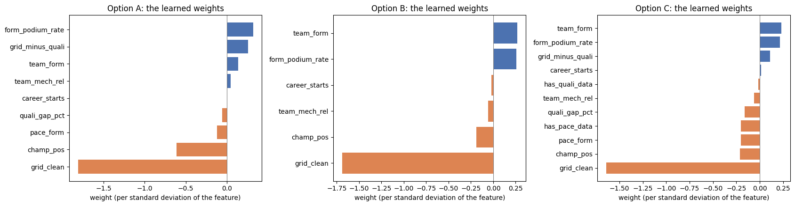

All three score each row on its own: none of them knows that a race has exactly 3 podiums.

### 5.2 Metrics: primary and secondary (§10.1, §10.10)

- **Primary: PR-AUC.** Podiums are the rare class (about 15% of rows) and the class we want to find. PR-AUC measures how well the podium finishers are ranked at the top and needs no threshold. It is used to choose every setting, the models carried forward and the features.
- **Secondary: F1**, at the threshold with the best F1 on the **validation** part (never the test part). It scores the yes/no answers the model would actually give.
- **ROC-AUC** is reported for every model but is high for everyone, the grid included (0.913 on the test part against 0.918–0.939 for the models), because 58% of the non-podium drivers start P11 or further back and are easy to rank. **Accuracy** is misleading: answering "no podium" for everyone is already 85.0% accurate, and the carried-forward models reach only 89.0–91.8%.
- Precision, recall and the **top 3 per race** (how many of each race's 3 most likely drivers reached the podium) are extra checks. "The top 3 on the grid finish on the podium" is the reference that needs no model.

### 5.3 Model comparison (§10.5, §10.6, §10.9)

Every model was trained on its option's training part only; validation and test scores come from that same model, with its threshold chosen on validation. The grid reference is the same in every option.

**Validation part (2019–2021).**

| Option | Model | ROC-AUC | PR-AUC | F1 | Precision | Recall | Top-3 per race | F1 threshold |
|---|---|---|---|---|---|---|---|---|
| – | the top 3 on the grid | 0.917 | 0.676 | 0.717 | 0.717 | 0.717 | 0.717 | – |
| A | logistic regression | 0.932 | 0.717 | 0.730 | 0.679 | 0.789 | 0.678 | 0.368 |
| A | **gradient boosting** | **0.940** | **0.747** | 0.731 | 0.673 | 0.800 | 0.706 | 0.345 |
| A | neural network | 0.938 | 0.747 | 0.735 | 0.684 | 0.794 | 0.700 | 0.369 |
| B | logistic regression | 0.927 | 0.702 | 0.738 | 0.693 | 0.789 | 0.694 | 0.367 |
| B | gradient boosting | 0.936 | 0.735 | 0.740 | 0.696 | 0.789 | 0.706 | 0.351 |
| B | neural network | 0.933 | 0.731 | 0.738 | 0.698 | 0.783 | 0.694 | 0.425 |
| C | logistic regression | 0.930 | 0.709 | 0.725 | 0.664 | 0.800 | 0.700 | 0.319 |
| C | **gradient boosting** | 0.935 | **0.744** | 0.740 | 0.701 | 0.783 | 0.706 | 0.362 |
| C | neural network | 0.935 | 0.741 | 0.733 | 0.693 | 0.778 | 0.694 | 0.414 |

**Test part (2022–2024, unseen until the end).**

| Option | Model | ROC-AUC | PR-AUC | F1 | Precision | Recall | Top-3 per race |
|---|---|---|---|---|---|---|---|
| – | the top 3 on the grid | 0.913 | 0.645 | 0.647 | 0.647 | 0.647 | 0.647 |
| A | logistic regression | 0.937 | 0.716 | 0.674 | 0.642 | 0.711 | 0.657 |
| A | **gradient boosting** | 0.939 | **0.717** | 0.665 | 0.629 | 0.706 | 0.652 |
| A | neural network | 0.933 | 0.702 | 0.670 | 0.626 | 0.721 | 0.657 |
| B | logistic regression | 0.932 | 0.712 | 0.645 | 0.616 | 0.676 | 0.657 |
| B | gradient boosting | 0.936 | 0.705 | 0.650 | 0.603 | 0.706 | 0.647 |
| B | neural network | 0.934 | 0.704 | 0.636 | 0.604 | 0.672 | 0.642 |
| C | logistic regression | 0.936 | 0.715 | 0.674 | 0.605 | 0.760 | 0.652 |
| C | **gradient boosting** | 0.937 | **0.704** | 0.659 | 0.618 | 0.706 | 0.642 |
| C | neural network | 0.933 | 0.706 | 0.656 | 0.636 | 0.676 | 0.647 |
| D-A | gradient boosting (random split) | 0.939 | 0.702 | 0.670 | 0.633 | 0.711 | 0.662 |
| D-C | gradient boosting (random split) | 0.918 | 0.652 | 0.627 | 0.557 | 0.716 | 0.598 |

**Training part** (PR-AUC / F1): logistic regression 0.675 / 0.652 (A), 0.560 / 0.561 (B), 0.563 / 0.577 (C); gradient boosting 0.714 / 0.688, 0.565 / 0.574, 0.568 / 0.567; neural network 0.703 / 0.671, 0.571 / 0.557, 0.591 / 0.570. The full training tables, with every metric, are in §10.2–10.4.

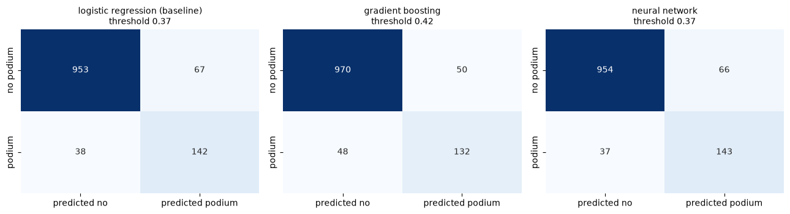

**The models carried forward: gradient boosting in options A and C (§10.6).** Gradient boosting in option A has the highest validation PR-AUC (0.747). It is clearly better than the grid (+0.071, 95% range +0.043 to +0.103), but against every other model except logistic regression in option B the difference is not clear: with 60 validation races the data cannot pick a single winner. Gradient boosting is preferred over the network because it gives the same model every time it is trained (the network's chosen run in option A was the best of five seeds). Options A and C are tied (0.747 against 0.744, range −0.025 to +0.032) and answer the question of the training seasons in two different ways, so **both are carried forward**; option B scores lower with every model and is dropped. Every model is still scored on the test part, but no choice is made from the test scores.

### 5.4 Feature-group ablation (§10.7)

For gradient boosting in options A and C, each of the 7 feature groups is removed in turn, the model is trained again with the same settings, and the change in validation PR-AUC is measured with its 95% range. In option C, each extra feature is removed with its group. Because overlapping groups can replace each other, each group is also trained **on its own**. The rule, set before the experiments: a group is removed only if the model is clearly better without it.

| Group | Change when removed, A (95% range) | Change when removed, C (95% range) | PR-AUC with this group only, A / C |
|---|---|---|---|
| grid | **−0.074** (−0.120 to −0.033), clear | **−0.059** (−0.091 to −0.022), clear | 0.677 / 0.676 |
| driver standings | −0.010 (−0.023 to +0.003) | −0.004 (−0.021 to +0.011) | 0.629 / 0.631 |
| pace | −0.011 (−0.023 to +0.003) | −0.004 (−0.015 to +0.005) | 0.595 / 0.568 |
| team form | +0.000 (−0.008 to +0.010) | +0.007 (−0.004 to +0.020) | 0.590 / 0.575 |
| driver form | +0.009 (−0.001 to +0.019) | −0.001 (−0.007 to +0.004) | 0.570 / 0.613 |
| qualifying | −0.008 (−0.023 to +0.008) | −0.006 (−0.033 to +0.019) | 0.495 / 0.491 |
| reliability | −0.006 (−0.016 to +0.005) | −0.002 (−0.005 to +0.001) | 0.236 / 0.222 |

With all features, the validation PR-AUC is 0.747 (A) and 0.744 (C); guessing gives about 0.150.

**Reading and decision.**
- **Only the grid is clearly needed, in both options.** No other group can replace the starting slot.
- **Every other group is strong on its own except reliability**, yet removing it costs little. The groups share their information (a driver in good form is usually high in the championship and in a strong team), so a small loss means a group can be **replaced**, not that it is useless.
- **Driver form in option A is the closest call** (+0.009, range −0.001 to +0.019): not clearly better without it, so it is kept by the rule.
- **All 7 groups are kept in both options.** None makes the model clearly better when removed, each was chosen with evidence and is valid at the cutoff, and a change smaller than the luck of 60 races is not a reason to drop it.

### 5.5 The random split (option D, §10.8–10.9)

**The question.** Does a random split of whole races give a validation score that is too optimistic? D-A and D-C keep the seasons and features of options A and C, draw 60 validation races at random from the seasons before 2022, learn the preprocessing again and choose the gradient-boosting settings again on their own validation races.

| Version | Settings chosen | Validation PR-AUC | Test PR-AUC | Test minus validation |
|---|---|---|---|---|
| A, time split | depth 2, 0.03, 300 trees | 0.747 | 0.717 | −0.030 |
| D-A, random races | depth 2, 0.03, 300 trees | 0.720 | 0.702 | −0.018 |
| C, time split | depth 2, 0.03, 100 trees | 0.744 | 0.704 | −0.040 |
| D-C, random races | depth 5, 0.1, 300 trees | 0.630 | 0.652 | +0.022 |
| D-C with option C's settings | depth 2, 0.03, 100 trees | 0.614 | 0.702 | +0.088 |

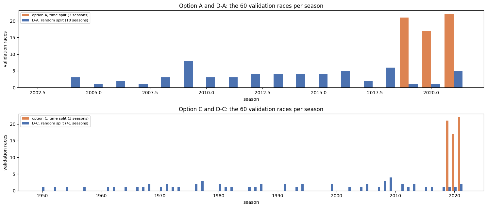

**Reading.**
- **The random split was not too optimistic.** Its validation races are spread over many seasons (18 for D-A, 41 for D-C), including older and harder ones, while 2019–2021 were unusually predictable, so the time split's validation score was the more flattering one here.
- **But the random split chose a worse model.** D-C chose the largest model, which reaches only 0.652 on the test. With option C's settings, the same random training races reach 0.702, clearly better (+0.050, range +0.014 to +0.087) and practically the same as option C (−0.002). Its validation races share their seasons with the training races, so it rewarded a model that learns patterns specific to each season, which did not carry over to 2022–2024.
- **So the time split is kept,** because it chooses models that do better on new seasons. This comes from one random draw, so the exact numbers would change with another.

### 5.6 The final test (§10.9)

The test part (2022–2024) was used once, with every setting, threshold and feature fixed beforehand.
- **Every model beats the grid on PR-AUC** (0.652–0.717 against 0.645). Both models carried forward beat it clearly: option A by +0.072 (range +0.041 to +0.102) and option C by +0.059 (+0.017 to +0.096). Form, standings, team and pace information add something beyond the starting order, also with the new 2022 cars.
- **The models are very close to each other.** Option C is not clearly different from option A (−0.013, range −0.034 to +0.007), and gradient boosting is not clearly better than logistic regression in either option (+0.002 in A, −0.011 in C). On the test seasons the simple baseline does as well as the flexible models.
- **Logistic regression keeps its validation score, the flexible models do not.** From validation to test, logistic regression changes by −0.001 to +0.010, while gradient boosting and the network lose 0.026–0.044. They had many settings chosen on the validation part, so their validation scores were a little flattering.
- **F1 drops for every model** (test 0.627–0.674 against 0.647 for the grid), because a threshold chosen on 2019–2021 fits 2022–2024 less well; 2022–2024 were harder for the grid too (F1 0.717 → 0.647).
- **Training again on 2019–2021 did not help.** Trained on all the seasons before 2022, option A's test PR-AUC falls from 0.717 to 0.704 (clear, range −0.025 to −0.002) and option C's from 0.704 to 0.698 (not clear). So the reported models are the ones trained on the training part only.
- **The top of the ranking is reliable:** among their 25 most confident test picks, the models of options A, B and C have 21–24 real podium finishers. The most confident misses are pole-sitters who did not finish on the podium (option A gave them 0.81–0.84), such as Verstappen in Australia 2024, who retired with a brake failure.

**In short.** No single model is chosen as a winner (§10.11). Gradient boosting in options A and C are the two models carried forward, explained in section 6 and used by the inference function in section 7. They beat the grid clearly on ranking (PR-AUC) but pick the three podium finishers of a race little better than the grid.

---

## 6. Model explainability (XAI)

**What is explained.** The two models carried forward: gradient boosting in **option A** (2003–2018, 9 features) and in **option C** (1950–2018, 11 features), exactly as scored in section 5, on the 1,359 driver-race rows of the test seasons 2022–2024, which neither model has seen. Every method is applied to both models, so the two explanations can also be compared. **Global** methods show what a model relies on overall; **local** methods show why it gave one driver one probability. Full details are in section 11 of the notebook.

**In short:** both models are mainly grid models. Where a driver starts matters most, and the history of the driver and the team corrects it. Option A spreads that correction over all 9 features, with the championship position first; option C puts it almost entirely into team form and uses only 4 of its 11 features. Their biggest mistakes come from what happens during the race, which no feature can know.

### 6.1 Permutation importance (§11.1)

One feature at a time is shuffled across the test rows, so it no longer says anything about the driver, and the drop in test PR-AUC is measured (20 shuffles each). The model is not trained again: this measures what the **trained** model uses.

| Feature | Option A: PR-AUC drop | Option C: PR-AUC drop |
|---|---|---|
| `grid_clean` | **0.353** | **0.350** |
| `champ_pos` | 0.017 | 0.020 |
| `form_podium_rate` | 0.013 | 0.016 |
| `quali_gap_pct` | 0.009 | 0.005 |
| `pace_form` | 0.006 | 0.008 |
| `career_starts` | 0.005 | 0.000 |
| `team_mech_rel` | 0.004 | 0.001 |
| `team_form` | 0.004 | **0.047** |
| `grid_minus_quali` | 0.000 | 0.000 |
| `has_quali_data`, `has_pace_data` | – | 0.000 |

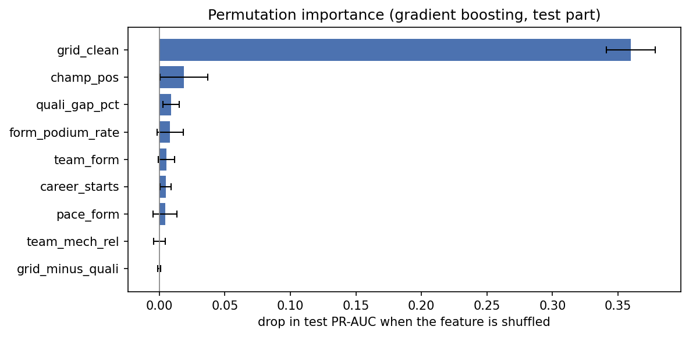

- **Both models rely on the grid far more than on anything else:** shuffling it lowers the test PR-AUC from 0.717 to about 0.36 (A) and from 0.704 to about 0.35 (C).
- **After the grid they differ.** Option A spreads its reliance over many features, each small. Option C relies on team form far more than on anything else (0.047, against 0.004 in A).
- **Option C never uses some features.** For career starts, the grid penalty and its two extra features the drop is exactly 0 with no spread: its trees never split on them.

**This understates features that overlap.** Driver form, the championship position, team form and pace carry much of the same information (correlations up to 0.80), so when one is shuffled the model uses the others. Shuffled **together**, these four groups lower PR-AUC by **0.134** in option A, three times the sum of their single drops (0.045), and by **0.187** in option C, twice the sum (0.091). All features except the grid together cost **0.193** (A) and **0.201** (C), about half as much as the grid (0.366 and 0.360): the history of the driver and the team is each model's second source of information, not an unimportant one.

### 6.2 SHAP: what pushes the predictions up or down (§11.2)

SHAP splits each prediction into one contribution per feature: a positive contribution pushes the driver towards the podium, a negative one away from it. Contributions are on the model's log-odds scale and, for tree models, add up exactly to the model's output (checked in the notebook: largest difference below 10⁻¹⁴).

| Average size of the contribution | Option A | Option C |
|---|---|---|
| `grid_clean` | 1.04 | 1.00 |
| `champ_pos` | 0.34 | 0.15 |
| `team_form` | 0.30 | **0.39** |
| `form_podium_rate` | 0.25 | 0.17 |
| `quali_gap_pct` | 0.20 | 0.01 |
| `pace_form` | 0.18 | 0.01 |
| `team_mech_rel` | 0.12 | 0.01 |
| `career_starts` | 0.06 | 0.00 |
| `grid_minus_quali` | 0.02 | 0.00 |
| `has_quali_data`, `has_pace_data` | – | 0.00 |

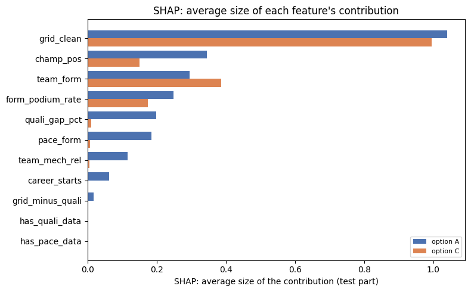

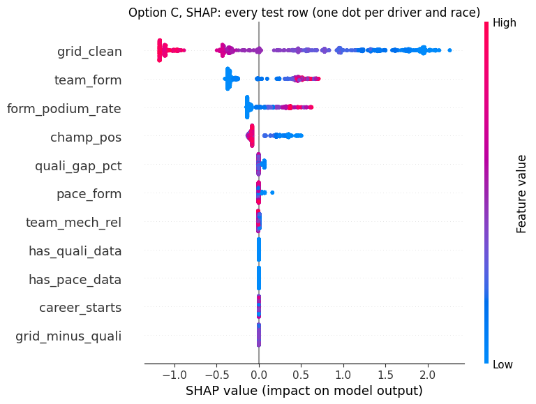

**What the two models use.**
- **Option A uses all 9 features.** After the grid come the championship position, team form, driver form, the qualifying gap and pace, then reliability, career starts and the grid penalty.
- **Option C uses only 4 of its 11 features:** the grid, team form, driver form and the championship position. The qualifying gap, pace and reliability move its score by 0.01 at most, and the other four features not at all.
- **Why option C uses so few.** Its model is small and stops early: 100 trees of depth 2 at a learning rate of 0.03 (option A has 300 trees), and its validation loss is still falling at the 100th tree (§10.3). And in its training seasons the qualifying and pace values are mostly filled (65% and 61%), which lowers their AUC from 0.830 to 0.678 and from 0.852 to 0.680 (section 4.3), while team form, driver form and the standings keep theirs (0.833–0.839). So those three win the splits.
- **Option C's probabilities are less extreme.** With few small trees, its scores stay closer to the average, so it gives a pole-sitter 0.62 where option A gives 0.84 (section 6.4). The calibration check (section 6.3) shows that this makes it under-confident.

**What the effects look like.**
- **Directions match the feature analysis (section 3), in both models:** a front grid slot, a high championship position, recent podiums and a strong team push up; in option A a slow qualifying lap or race pace and a team that breaks down often push down.
- **The grid effect is curved in option A:** pole adds +2.90 on average and 2nd +2.39; the push falls by about 0.5 per place to P7, is negative from P8, and from P11 to the back it is flat (P12 and P20 are treated the same). A linear model such as logistic regression cannot represent this.
- **Option C's grid effect is a staircase:** pole, 2nd and 3rd get almost the same push (+1.95, +1.97, +1.81), then it falls to about 0 at P10, stays at about −0.4 to P14 and drops to about −1.1 from P15. Its few small trees can only split the grid in a few places.

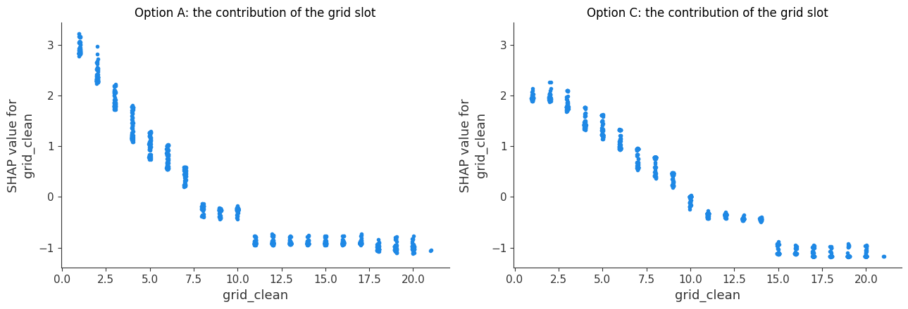

- **Other effects work in steps:** leading the championship and being 2nd count the same in both models (+0.71 and +0.74 in A), and the push turns negative from about 11th; driver form stops adding after about four or five podiums in the last ten starts. Option C's pushes are about half as large, because it puts this information into team form.

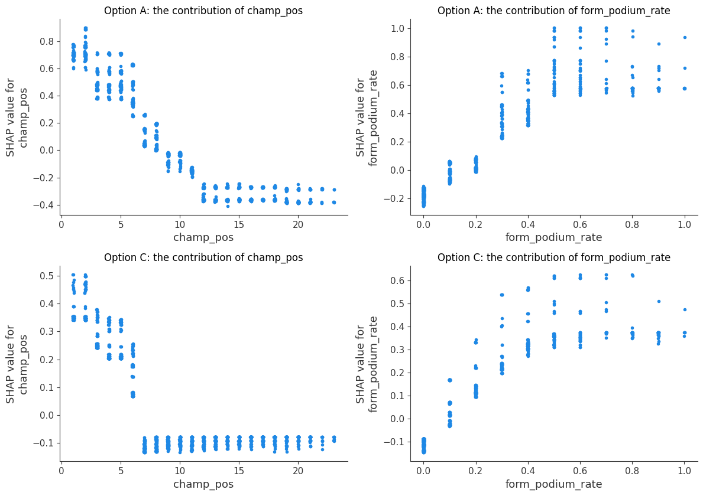

**An interaction: the grid and team form.** Gradient boosting can learn that the effect of one feature depends on another. Colouring the grid's SHAP contribution by team form shows a small one in both models: at the same slot from P1 to about P7, a driver of a weak team gets a larger push from the grid than a driver of a strong team (up to about 0.5 in option A, 0.3 in option C), and behind P11 a strong team loses a little less. A strong team already gets its push from team form and the standings, so the grid has less to add; for a weak team, a front slot is almost the only sign of a podium. The interaction is small next to the grid's own range of about 4 points, so both models are close to additive: **their advantage over logistic regression comes mainly from curved effects, and only a little from interactions.**

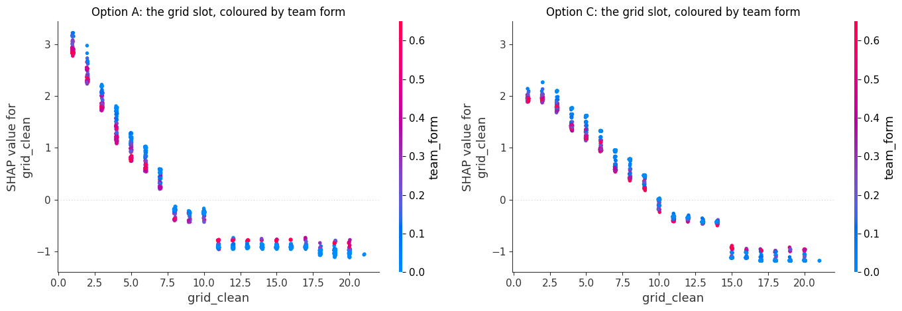

### 6.3 Are the explanations reliable, and can the probabilities be trusted? (§11.3)

- **Three measures agree on the top.** Permutation importance, SHAP and the ablation (section 5.4, models trained again without each group) all rank the grid first, in both models.
- **Permutation importance and SHAP agree closely** on the order of the groups (rank correlation 0.79 in A, 0.96 in C), because they measure the same trained model on the same rows.
- **The ablation agrees with them much less** (0.07 to 0.46). Apart from the grid its changes are small and none is clear, so its order of the middle groups is mostly chance. The clearest case is team form in option C: second in permutation importance and SHAP, but the model trained again without it is not worse (+0.007), because driver form and the standings then carry the same information.
- **The explanations do not depend on one season.** The SHAP ranking is almost identical in 2022, 2023 and 2024 (rank correlation 0.98–1.00 in A, 0.99–1.00 in C), so it is not driven by Red Bull's dominant 2023.

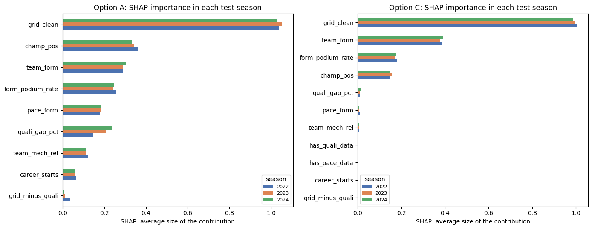

**The baseline relies on the same top features, by a different route.** On the test part logistic regression scores as well as gradient boosting (0.716 against 0.717 in A, 0.715 against 0.704 in C), so its contributions (weight × scaled value, in the same log-odds units as SHAP) were compared with the SHAP sizes. Both put the grid first, and in option A the championship position second; logistic regression leans on them even more (1.45 and 0.48 against 1.04 and 0.34). The rankings agree fairly well in option A (rank correlation 0.70) and less in option C (0.59): there, logistic regression still uses the filled qualifying and pace values (0.14 each), which a straight line cannot ignore, and gives `has_pace_data` a large but constant shift that changes no ranking on the test part. Different models reach the same score with the features in different amounts, because the history features overlap.

**Can the probabilities be read as chances? (calibration)** The test rows were grouped by their predicted probability and compared with the share that really reached the podium.
- **Option A is well calibrated:** in every group the real rate is within the 95% range of the prediction (for example 44% predicted against 45% real, and 84% against 82% for its most confident predictions), and it expects 205 podiums against 204 real.
- **Option C is under-confident at the top:** above about 0.4 its drivers reach the podium more often than predicted (55% against 70%, 62% against 78%, outside the 95% range), and its highest predictions are only about 0.63. Its ranking is still good, because the order of the drivers is right; only the size of its probabilities is too cautious (Brier score 0.0737 against 0.0690).
- In both models the probabilities of a race add up to 3.02 on average (2.6 to 3.4 in single races), although nothing forces them to.

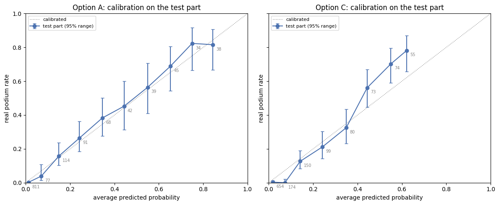

### 6.4 Local: single predictions with SHAP (§11.4)

Rows are chosen by a rule, not by hand: for each model, the pole-sitter it was least sure about, the driver from P5 or further back it was most sure about, and its most confident prediction that missed the podium.

**The pole-sitter: Russell, Canada 2024 (both models pick him), reached the podium.** Option A gives 0.45: pole adds +3.17 and every other feature together only +0.06, the largest being his team's weak recent results (−0.22). Option C gives only 0.25: the grid adds less (+2.14) and the weak team form costs more (−0.32).

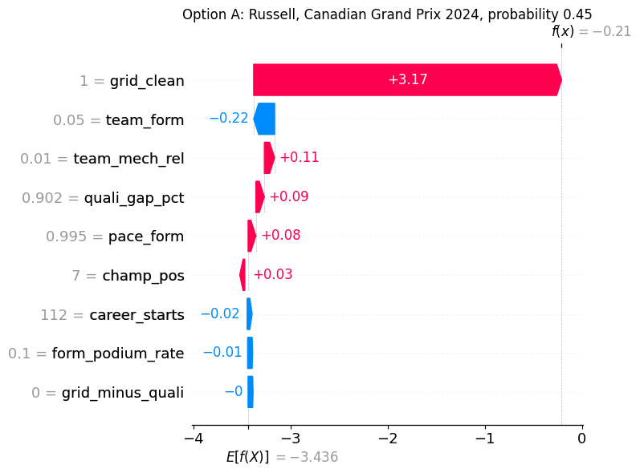

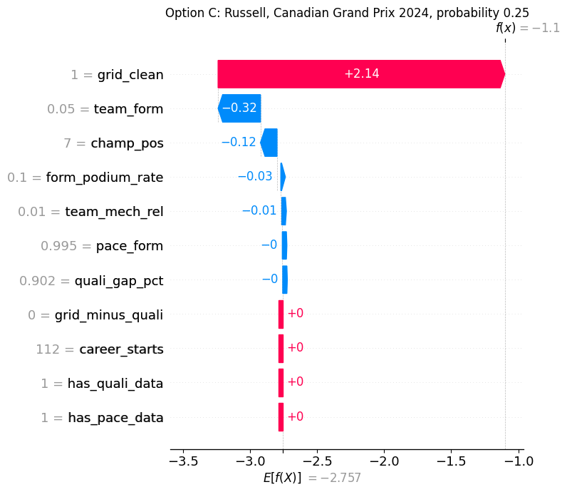

**From further back, the two models pick different drivers.**
- **Option A: Verstappen, United States 2023, from P6 (0.50), reached the podium.** The grid is only the third push (+0.61); more comes from his form (9 podiums in his last 10 starts, +0.72) and from leading the championship (+0.67), and every other feature also pushes up. The probability comes from the whole history of the driver and the team.
- **Option C: Leclerc, Spain 2024, from P5 (0.42), did not reach the podium.** The grid (+1.21), team form (+0.48), his 2nd place in the championship (+0.35) and his form (+0.34) make the whole prediction; every other feature adds 0.07 or less. A probability of 0.42 is less than even, so missing the podium was the more likely outcome.

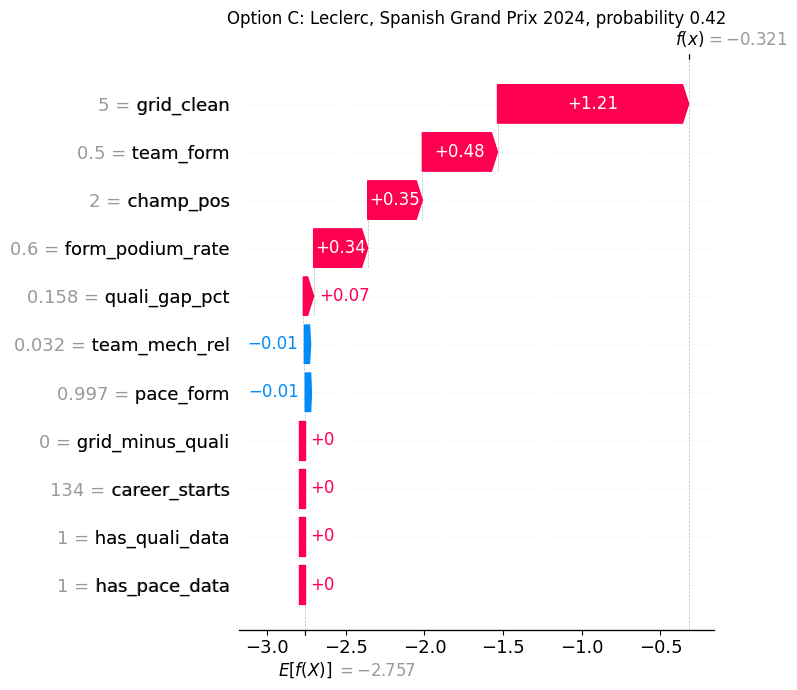

**Confident predictions that were wrong.**
- **Option A: Verstappen, Australia 2024, from pole: probability 0.84, retired with a brake failure** (classified 19th). Every feature pushed up (grid +2.86, championship +0.71, form +0.57, team +0.33, qualifying gap +0.32), so the explanation is sensible; the cause of the miss is not in the information available before the race.
- **Option C: Verstappen, Austria 2024, from pole: probability 0.63, finished 5th.** Again every feature pushed up (grid +1.95, team form +0.52). Option C's most confident miss is less confident than option A's, because its probabilities are less extreme.
- **A high probability is not a promise.** Option A is well calibrated: of its predictions above 0.8, 82% reached the podium, so about one in five misses. Option C's 0.63 understated Verstappen's chance, since 78% of its predictions between 0.6 and 0.7 reached the podium. One confident miss is not a sign that a model is wrong; many would be.

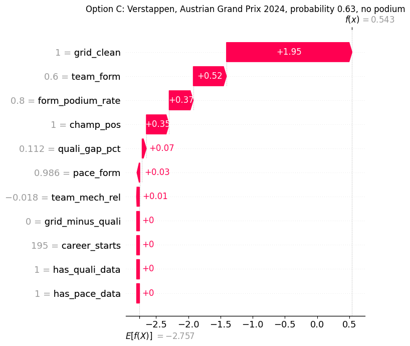

### 6.5 Local: LIME (§11.5)

LIME fits a simple straight-line model to 5,000 made-up drivers near the real one, to approximate the real model around that prediction. It was applied to the driver from further back of each model.
- **Option A, Verstappen, United States 2023:** every condition raises the probability, as in SHAP, but LIME puts the grid first ("grid ≤ 6": +0.18 in probability), then driver form, the standings and team form (+0.04 each), while SHAP put the grid third. LIME's broad conditions compare him with made-up drivers from all over the grid, and its weights are in probability while SHAP's are in log-odds, so the sizes cannot be compared directly.
- **Option C, Leclerc, Spain 2024:** LIME and SHAP agree on the features and on their order (grid +0.21, team form +0.06, standings and form +0.03 each); every other condition, the two extra features included, gets 0.006 or less. LIME also finds that option C uses only four features.
- **LIME is approximate:** its simple model gives 0.35 for both drivers where the real models give 0.50 and 0.42. SHAP, which is exact for tree models, is the main method; LIME is the cross-check.

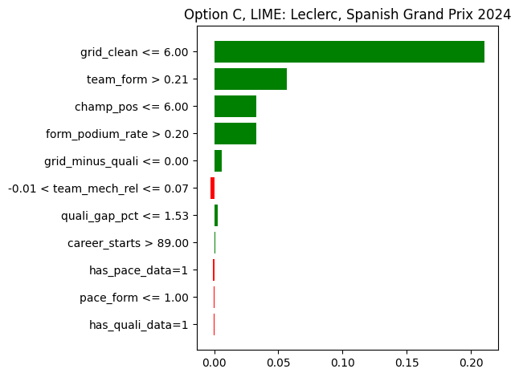

### 6.6 A whole race (§11.6)

At Australia 2024 (the race of option A's most confident miss), both models' top three were exactly the top three on the grid, and both got 2 of the 3 podiums right: Verstappen retired and Leclerc, the 4th pick of both models, took his place. The other features only reorder neighbours (both put Pérez from P6 above Piastri from P5: option A because of his championship position, option C because of Red Bull's team form). In option C, team form is the largest push apart from the grid for every driver. Behind P10 the grid decides almost everything. This shows the models' main limitation: they improve the probabilities but rarely change who is in the top three.

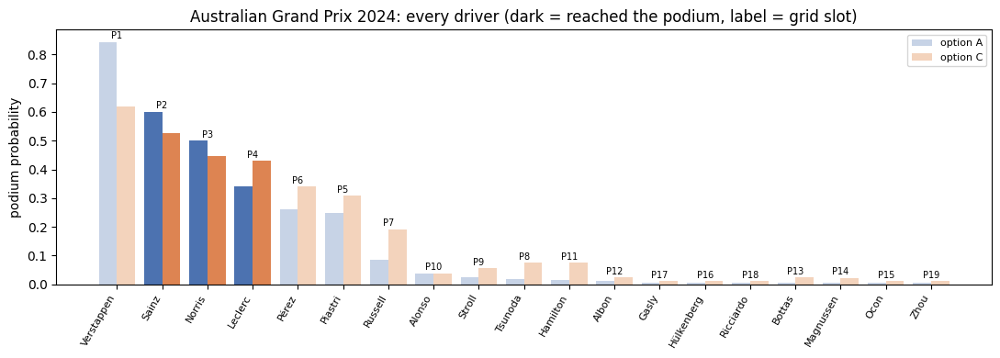

### 6.7 What these explanations do not show (§11.7)

- **Importance is not causation.** A feature being important to a model is **not proof that it causes podium finishes**; it only means that the model relies on it to make predictions. For example, leading the championship does not make a driver faster: a fast car and a strong driver cause both the championship position and the podiums, and the model uses the championship position as a sign of them.
- **Two equally good models, two different explanations.** Options A and C score almost the same on the test, yet A relies on the championship position and C on team form. Features that overlap can stand in for each other, so the importance of one says more about the model than about the race. A feature a model ignores is not useless either: option C ignores the qualifying gap and pace, which option A uses and which are strong on their own (section 3).
- **The grid slot mixes two things:** the advantage of starting at the front and how fast the car was in qualifying. The models cannot separate them.
- **Overlapping features share their importance,** so a feature that looks unimportant alone can still carry real information (section 6.1).
- **The explanations hold for these models and these seasons** (2022–2024); another model or other seasons could rely on the features differently.

---

## 7. Inference function

`predict_podium(record, option='A' or 'C', race_worst_champ_pos=None)` (§12) predicts one new record, one driver in one race at the cutoff, with either model carried forward. It runs the same steps as the pipeline:
1. It takes the option's features in original units: the 9 features, and in option C also `has_quali_data` and `has_pace_data`. Any of the 9 may be missing except `grid_clean` and `career_starts`, which are always known at the cutoff; the function refuses a record without them (or, in option C, without the two extra features).
2. It fills the gaps with the rules of section 4.3, using the fill values learned from the **option's own training part**. A missing `champ_pos` is filled with the worst position in the race + 1, so for such a record the function also takes the worst championship position among the other drivers.
3. It caps and scales the values with the option's limits and scaler.
4. It runs the option's model, as scored in section 5, and returns the podium probability, the yes/no answer at the threshold chosen on validation (0.345 for A, 0.362 for C), and a table of the values the model actually used.

| Record | Option A | Option C | Actual result |
|---|---|---|---|
| **Complete:** Verstappen, United States Grand Prix 2023, every feature known | 0.50, podium | 0.37, podium | podium |
| **Partially missing:** Zhou, Bahrain Grand Prix 2022, his first race; driver form, championship position and pace missing | 0.01, no podium | 0.01, no podium | no podium |

For Zhou, the gaps are filled with 0 (no podium yet), 20 (the worst position in the race, 19, + 1; three other drivers without a standing also got 20) and the training median pace of 1.000. For both records and both models, the function gives exactly the probability the notebook computed for that row in the final test, so it repeats the pipeline's steps correctly.

---

## 8. Known limitations

**Data coverage**
- **Historical qualifying-coverage drift.** Qualifying data starts in 1994, covers only 6–59% of the races in 1996–2002 and is complete again from 2003; lap times start in 1996. Option A therefore learns from 2003–2018 only and leaves more than 50 seasons unused. Option C keeps those seasons but has to fill 61–65% of its qualifying and pace values, which weakens these features (AUC 0.830 → 0.678 and 0.852 → 0.680), so its model hardly uses them. Neither way of handling the drift is clearly better on the test (0.717 against 0.704).
- **Pit-lane starts are only recorded from 2015.** Before that, the data gives pit-lane starters a slot at the back of the grid, so they cannot be flagged (`grid_clean` places both at the back, so the effect is small).
- **Renamed teams start with no history.** Brawn 2009 is not linked to Honda 2008, because a new name often means a new owner and car; a strong new team is first filled as "typical" and only the grid shows its speed.
- **Fill rules are guesses for debuts.** A rookie gets a form of 0 and a median pace. In options A and B few rows are affected (at most 4% per feature), but the model knows little about a driver's first race.

**Era sensitivity**
- **The sport's rules change.** Points systems, calendar length, car reliability and grid size change across eras, so raw totals are replaced by ranks, rates and values relative to the field. Even so, what a feature means shifts: the grid predicted the podium much less well before 2003 (the top 3 on the grid reached the podium 54% of the time in 1950–2018, against 72% in 2019–2021), and today's drivers have far more career starts than the training average (section 4.3).
- **New regulations.** The test seasons start with the 2022 car rules. Every score is lower on the test part than on validation, the grid's too (PR-AUC 0.676 → 0.645), so performance depends on the era; a future rule change could lower it again.
- **Validation-chosen choices did not fully carry over.** The flexible models lost 0.026–0.044 PR-AUC from validation to test while logistic regression did not, the F1 thresholds fit the test seasons less well, and training again on the newest seasons (2019–2021) made option A slightly worse.

**The models**
- **Mainly grid models.** The grid slot is by far the most important input. The models clearly beat the grid on ranking (PR-AUC), but picking 3 drivers per race they do little better than the top 3 on the grid (test: 64.2–65.2% for the two models carried forward, against 64.7%).
- **Each row is scored on its own.** No model knows that a race has exactly 3 podiums, so the probabilities within a race do not add up to exactly 3 (2.6 to 3.4 on the test part).
- **Option C's probabilities are too cautious.** It ranks the drivers well, but above about 0.4 its drivers reach the podium more often than it predicts (section 6.3), so its probabilities should not be read as exact chances; option A's can.
- **What happens in the race is unknown at the cutoff.** Crashes, breakdowns, safety cars, weather and strategy decide many podiums, and the models' most confident mistakes are such cases (Verstappen, Australia 2024, pole and a brake failure).
- **Small evaluation sets.** Validation has 60 races and the test 68, so many differences are within luck: gradient boosting is not clearly better than the baseline on the test, and options A and C are not clearly different.
- **Results depend slightly on the computer.** The network's numbers move with its random start and with the maths libraries (mean of 5 seeds 0.733 ± 0.020 in option C). The tree models are deterministic, but on another computer with another scikit-learn version the tuning of option C chose different settings; ties to three decimals go to the smaller model to limit this. The numbers in this report come from the submitted Kaggle run.

**The data-engineering answers**
- They describe associations, not causes, and rest on small samples per circuit (about 10 races per period in Q1) and per team (Q3); Q2 relies on mapping nationalities to countries, and Q3 on grouping the status labels, where unclear labels such as `Retired` only give an upper bound.

**The explanations** describe the models, not Formula 1: an important feature is not proof that it causes podium finishes (section 6.7).
